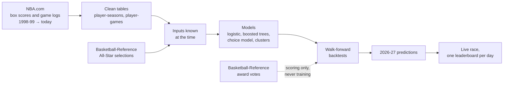

# NBA Unicorn & Breakout Hunting


**Could we have identified future NBA breakouts, stars and "unicorns" before they became obvious, using only what was known at the time?**

This project treats scouting like backtesting an investment strategy. For every past season, it rebuilds what was knowable at that moment, ranks the players, and then scores those rankings against what actually happened. Only after a method has passed that test is it applied to current players. The Most Improved Player and playing-style work goes back to 2000-01; the breakout and star work starts in 2011-12.

> [!NOTE]
> **Live: the 2026-27 Most Improved race.** Ty Jerome leads with about an 8% chance on 8 November (day 20 of the season), ahead of a close field. His chance was 26% until the model learned that players returning from a lost season have never won: [is his lead believable?](#is-ty-jeromes-lead-believable)


## At a glance

| Question | Short answer | Evidence |
|---|---|---|
| Are breakouts predictable a season ahead? | **Partly:** 4–6× better than random | Strict walk-forward backtest, 2014-15 → 2024-25 |
| What predicts a future star? | **Current all-round quality**, ahead of any model (10× random) | 26 future stars; two routes to stardom |
| What is a "unicorn"? | **Two kinds:** rare *combinations* of strengths (Giannis Antetokounmpo, Nikola Jokić) and *extremes* with no comparable players (Victor Wembanyama) | Rarity and strangeness scores |
| How many kinds of player are there? | **Eight** by playing style, from *Mr. Inside the Key* to *The Effective Operator* | Clustering of 5,353 player-seasons |
| Can the Most Improved Player be named from the box score? | **Often:** #1 at season's end in 7 of 21 seasons, top 3 in 11 (each season judged only from earlier ones) | 2000-01 → 2025-26 |
| What do Most Improved voters reward? | A large jump in scoring and production, a team that improves, a player who is young and **not already a star** | No winner in 26 years had been an All-Star |
| What is the best clue before the season? | **An open role:** a 20-point scorer has left the player's team | 7 of 21 winners, against 11% of candidates |
| Has the predictor improved as we learned? | **It roughly doubled in sharpness:** from 11× to 25× a blind guess at season's end, one tested decision at a time | [How the predictor evolved](#how-the-predictor-evolved) |

## Contents

- [The project in one picture](#the-project-in-one-picture) · [How to read this project](#how-to-read-this-project)
- [Breakouts and stars](#breakouts-and-stars) · [Unicorns](#unicorns) · [Eight kinds of player](#eight-kinds-of-player)
- [Most Improved Player](#most-improved-player): [what voters reward](#what-voters-reward) · [before the season](#before-the-season) · [already an All-Star](#why-already-an-all-star-counts-against-a-player) · [how the predictor evolved](#how-the-predictor-evolved)
- [The live 2026-27 race](#the-live-2026-27-most-improved-race): [is Jerome's lead believable?](#is-ty-jeromes-lead-believable) · [are the chances honest?](#are-the-chances-honest) · [the blip test](#the-blip-test-did-alexander-walkers-leap-last)
- [How it works](#how-it-works) ([terms used throughout](#terms-used-throughout)) · [Key decisions](#key-decisions) · [Reproduce](#reproduce) · [Limitations](#limitations) · [What's next](#whats-next)

---

## The project in one picture



Every arrow runs forward in time. A prediction for a season uses only seasons, games and selections that came before it. Award votes are used only to mark predictions, never to train a model.

---

## How to read this project

The notebooks are numbered in the order the work was done, not the order a reader needs. Choose a route below. Every notebook opens with **In brief** (question, answer, decisions, where it fits), so reading just those blocks along a route gives the whole story; the [terms](#terms-used-throughout) are defined once, below.

**In ten minutes**
1. This page: [at a glance](#at-a-glance), then [the live race](#the-live-2026-27-most-improved-race).
2. [Notebook 19](notebooks/19_predictor_evolution.ipynb): the Most Improved model rebuilt one decision at a time. The best single notebook for seeing how the project reasons.
3. [The eight kinds of player](docs/EIGHT_CLUSTERS.md).

**Route 1: Most Improved Player** (the main thread)

| Step | Notebook | Why read it |
|---|---|---|
| 1 | [10](notebooks/10_mip_leaps.ipynb) | How winners' seasons unfolded, and the first model of what voters reward. Historical, but it is where the reasoning starts |
| 2 | [14](notebooks/14_team_changes.ipynb) | Where the best preseason clue came from: a 20-point scorer leaving |
| 3 | [11](notebooks/11_mip_preseason.ipynb) | Predicting before a game is played |
| 4 | [17](notebooks/17_already_a_star.ipynb), [18](notebooks/18_ty_jerome_effect.ipynb) | Two questions the live race raised, each tested and turned into an input |
| 5 | [19](notebooks/19_predictor_evolution.ipynb) | What every decision added, on one test bed |
| 6 | [20](notebooks/20_calibration.ipynb) | Whether the chances can be taken at face value |
| 7 | [12](notebooks/12_mip_live_race.ipynb) | The live race, using everything above |
| 8 | [16](notebooks/16_do_leaps_last.ipynb) | Does a leap last? The blip test on 609 past leaps |

[15](notebooks/15_mip_2000_2026.ipynb) is optional: notebook 19 reruns its test with every later decision.

**Route 2: Breakouts and stars**

| Step | Notebook | Why read it |
|---|---|---|
| 1 | [02](notebooks/02_player_seasons.ipynb), [03](notebooks/03_player_trajectories.ipynb) | The data: shrinkage, season-relative measures, and how each player has been changing |
| 2 | [05](notebooks/05_breakout_hunting.ipynb) | What counts as a breakout and a star |
| 3 | [06](notebooks/06_breakout_backtest.ipynb) | The backtest: which models work, honestly tested |
| 4 | [09](notebooks/09_routes_to_stardom.ipynb) | Two routes to stardom |
| 5 | [08](notebooks/08_breakout_board.ipynb), [07](notebooks/07_current_players.ipynb) | Every past season's picks, then the 2026-27 outlook |

**Route 3: Unicorns and playing styles:** [04](notebooks/04_unicorn_hunting.ipynb) (rare combinations and extremes), then [13](notebooks/13_archetypes.ipynb) (the eight kinds of player).

**For checking the data:** [00](notebooks/00_setup.ipynb) and [01](notebooks/01_data_exploration.ipynb) show which NBA.com sources can be trusted, and why some cannot.

---

## Breakouts and stars

Strict walk-forward backtest[^strict], predictions for 2014-15 → 2024-25, players aged 25 or under ([notebooks 05–09](#how-it-works)):

| Outcome | How rare | Best model | Lift over random (95% CI) |
|---|---|---|---|
| Any breakout next season | 6.9% | Boosted trees | **4.2×** (3.3–5.3) |
| Scoring breakout next season | 4.9% | Boosted trees | **6.1×** (4.9–8.0) |
| Star season within 3 years | 1.6% | Current star score | **10×** (6.7–23) |

<details>
<summary><b>Findings, charts and Egor Dëmin</b></summary>

- **Simple is nearly as good as complex.** A 12-signal logistic regression reaches about 90% of the 197-feature model. The signals in favour are earning minutes already, rising usage and minutes, self-creation and efficiency. Those against are age, a late draft position and usage that is already high.
- **For stardom, current all-round quality beats every model.** With only about 26 future stars to learn from, extra features overfit.
- **There are two routes to stardom.** Some players break out (Shai Gilgeous-Alexander, Giannis Antetokounmpo, Nikola Jokić); others climb steadily without a single breakout season (Anthony Edwards, Devin Booker, Donovan Mitchell). Steady risers are visible early from current quality alone (8.6× random); breakout-route stars need trajectory signals (4.6–5.6×).
- **The models read trajectories, not single seasons.** Shai was ranked 37th of 229 young players after his rookie year, then 12th after his second.
- **Egor Dëmin after one season:** a typical 5.3% breakout chance for 2026-27. His rookie profile most resembles Kevin Huerter, Tyler Herro, Jamal Murray and Klay Thompson: shooters who broke out more often than average but rarely became stars.

| | |
|---|---|
|  |  |
| Walk-forward lift over random, with bootstrap intervals | Shai Gilgeous-Alexander against LaMelo Ball, season by season |
|  |  |
| Where players with a rookie season like Dëmin's went | Each season's top-10 breakout picks against what happened |

</details>

## Unicorns

Rare *combinations* of strengths (Giannis, Jokić, Kevin Durant) are distinct from *extremes* with no comparable players. Victor Wembanyama is the most extreme player in the data.

<details>
<summary><b>The unicorn map</b></summary>


2025-26: the rarity of each player's skill mix (pairs of strengths that seldom occur together) against his strangeness (distance to the most similar players).

</details>

## Eight kinds of player

**How do players play, rather than how well?** Every player-season since 2011-12 with 500+ minutes was grouped by 15 style measures: where he shoots, how he creates, how he rebounds and his box-score defence. Each measure is compared with that season's league.

> [!IMPORTANT]
> **The data drew the groups; we named them afterwards.** No names, size or position went into the clustering, and no list of expected types was written beforehand ([D31](docs/DECISIONS.md)). This stops the analysis from forcing players into categories we already believe in. Full write-up: [docs/EIGHT_CLUSTERS.md](docs/EIGHT_CLUSTERS.md).

| | Name | Best-known members | What the data says |
|---|---|---|---|
| 1 | **Mr. Inside the Key** | DeAndre Jordan, Rudy Gobert, Dwight Howard | Rim shots, offensive rebounds, blocks; no threes |
| 2 | **Windex** | Karl-Anthony Towns ('16-17), Amen Thompson, Domantas Sabonis | Rebounds at both ends, paint touches; few threes |
| 3 | **Bruiser** | Al Horford, Michael Porter Jr., Brook Lopez | Defensive rebounds, blocks, fouls; rarely creates his own shot |
| 4 | **The Pest** | Mikal Bridges ('21-22), Josh Hart, OG Anunoby | Fast breaks, corner threes, steals; low usage |
| 5 | **Give Me the Ball and Let Me Work** | James Harden, Kevin Durant, LeBron James | Self-created baskets, assists, usage; mid-range |
| 6 | **Peter Griffin's NBA Jam** | Trevor Ariza, P.J. Tucker, Toumani Camara | The most threes of any group; almost no self-creation, rim shots or free throws |
| 7 | **Kerr's Cult** | Klay Thompson, Nicolas Batum, Mikal Bridges ('24-25) | Threes and movement; few rim shots or rebounds |
| 8 | **The Effective Operator** | Damian Lillard, Stephen Curry, CJ McCollum | Self-created baskets, assists, usage; smaller, fewest rebounds |


- **Players move between kinds as their game changes.** Mikal Bridges moved from The Pest to Kerr's Cult; Karl-Anthony Towns began as a Windex before he became a shooting big.
- **2025-26 surprises:** Wembanyama is a Windex rather than a Bruiser, because his rim shots and rebounding outweigh his threes relative to the league. Draymond Green is in Kerr's Cult.

<details>
<summary><b>How many groups, and why eight</b></summary>

Playing style turned out to be mostly a continuum rather than a set of islands. To judge how many groups are real, the clustering was fitted on two random halves of the data and the two results compared (1 = identical groups).

| Groups | 3 | 5 | 6 | 8 |
|---|---|---|---|---|
| Agreement between halves (2011-26) | 0.94 | 0.87 | 0.76 | 0.54 |

Five groups are the most stable fine-grained choice. Eight were chosen ([D35](docs/DECISIONS.md)) because the eight fit neatly inside the five and each extra split has a clear basketball reading: stretch bigs, corner 3-and-D wings, and two different kinds of on-ball creator.

</details>

<details>
<summary><b>Back to 2000-01: how the league changed</b></summary>

The same exercise over 26 seasons, on 3-season rolling windows and with **no era adjustment**, so the league's changes show up directly ([notebook 13E](notebooks/13_archetypes.ipynb), [D36](docs/DECISIONS.md)):

- **The traditional rim big fell from 23% of players to 5%.** It was the largest group until about 2012, then collapsed by 2018.
- **The corner 3-and-D wing rose from 4% to 20%.** Bruce Bowen, Raja Bell and Shane Battier came first; Trevor Ariza and P.J. Tucker followed.
- **Usage-heavy and pick-and-pop bigs held steady at 6–9%,** from Kevin Garnett, Tim Duncan and Dirk Nowitzki to Jokić, Giannis and Towns.


These longer-run groups are less stable (0.45 agreement at eight), partly because players near a boundary switch groups as the league shifts around them.

</details>

## Most Improved Player

**Could each Most Improved Player (MIP) have been named from the numbers, and what do the votes say "improved" means?** ([notebook 10](notebooks/10_mip_leaps.ipynb))

The model is a **choice model** (conditional logit): in each season exactly one eligible player wins, so every player's score is turned into a share of a single 100% chance:

$$
P(\text{player } i \text{ wins season } s) \;=\; \frac{\exp\!\left(x_i^{\top}\beta\right)}{\sum_{j \,\in\, \text{eligible}(s)} \exp\!\left(x_j^{\top}\beta\right)}
$$

where $x_i$ holds the player's inputs (changes in his box-score numbers, his team's change in winning, his age and so on). The penalty on the weights is λ = 3 ([D30](docs/DECISIONS.md)).

| Test | Result |
|---|---|
| Winner ranked #1 from about 300 eligible players, each season predicted from the others (2011-12 → 2025-26) | **8 of 15 seasons** (median winner rank 1) |
| The same model trained on earlier seasons only | 5 of 10 seasons |
| Strictly earlier seasons only, game logs only, 2005-06 → 2025-26 ([notebook 15](notebooks/15_mip_2000_2026.ipynb)) | #1 in **7 of 21**, top 3 in 11; median winner rank 2 |
| Our top 7 against the real voting top 7 | 3.1 of 7 in common, on average |

<details>
<summary><b>Approach</b></summary>

- **Data:** 404,000 player-games (2010-11 → 2025-26), with Hollinger game score[^gamescore] as the one-number summary of a game; game logs back to 1998-99 for the longer history.
- **Baseline:** each player's own previous season, skipping injury-shortened ones, so a healthy return is not counted as a leap.
- **Inputs:** the change in every box-score statistic, both absolute (ΔX) and relative (Δ%), plus the team's change in winning percentage, age and a second-year flag.
- **Evaluation:** real vote totals ([Basketball-Reference](https://www.basketball-reference.com/awards/)) are used only to mark predictions, never to train.

</details>

### What voters reward

- **Size beats percentage.** The absolute jump alone names the winner in 7 seasons; the relative jump alone in 4.
- **Voters reward** a jump in all-round production (odds ×1.57 per extra point of game score), in scoring (×1.39 per extra point a game), a larger offensive load, and a team that improved (×1.28 for winning 10% more games).
- **Voters discount** age (×0.88 per year), gains that come only from extra minutes, and above all second-year players: 19% of the voting top 7, but no winner in the last 15 seasons (the last was Monta Ellis in 2006-07).
- **Voters pass over players who are already stars.** No winner from 2000-01 to 2025-26 had been an All-Star before his winning season ([see below](#why-already-an-all-star-counts-against-a-player)).
- **Most winning leaps are visible from opening night.** For 11 of 15 winners, the first 10 games already held 80% or more of the season's jump. One huge night is not a signal: after 1,109 "eruption" games, the next seven looked like the seven before.
- **The winners the model misses crossed a milestone** rather than making the largest jump: a first 20-point season (Goran Dragić), a first star-level season (Julius Randle), or becoming the team's leading scorer (Tyrese Maxey, Paul George).

<details>
<summary><b>Charts: chances, weights and every winner's season</b></summary>

| | |
|---|---|
|  |  |
| Predicted chance of winning (blue = our top 3; orange star = the actual winner) | Every model weight, with 90% ranges from 500 refits |
|  |  |
| Each winner's season, week by week, against his baseline | Our top 7 against the real voting top 7 |


*Three views of every season since 2005-06, each predicted from earlier seasons only: the end of the previous season (median winner rank 51), mid-season (4) and the end of the season (2).*

</details>

### Before the season

**Who is set up to improve before a game has been played?** ([notebook 11](notebooks/11_mip_preseason.ipynb))

- **Preseason form is used per 36 minutes, never as totals**, and small samples are shrunk towards zero:

  $$\text{weight of a preseason change} \;=\; \frac{\text{preseason minutes}}{\text{preseason minutes} + 150}$$

  so 50 preseason minutes count for a quarter and 150 for a half. Minute increases in preseason hold at about 60–75%, decreases mean almost nothing, and shot volume per minute is the most reliable signal.
- **Established scorers are handled by a turning point, not a rule** ([D27](docs/DECISIONS.md)). Last season's scoring counts slightly in a player's favour up to 20 points a game and against him above it, because a 25-point scorer is an MVP candidate, not an MIP one:

  $$\beta_1 \cdot \text{ppg} \;+\; \beta_2 \cdot \max(0,\ \text{ppg} - 20)$$

  Every turning point from 14 to 26 was backtested; 20 fitted best.
- **A star leaving matters more than changing teams** ([notebook 14](notebooks/14_team_changes.ipynb), [D29](docs/DECISIONS.md)). Winners changed teams no more often than anyone else (29% against 27%), but 7 of 21 had a 20-point scorer leave their team (against 11% of candidates). A yes/no input, "a 20-point scorer left and was not replaced", lifted the winner into our preseason top 7 in 7 of 14 seasons, up from 3. Finer scoring bands fitted better on paper, but they learned a shape with no basketball sense (losing a 21-point scorer "hurt", losing a 23-point scorer helped), so the simple version was kept.
- **Track record:** from about 375 candidates a season, the eventual winner was in our preseason top 7 in **9 of 14 seasons** (5 of 9 in the strict test, median rank 7). 44% of top-7 picks went on to jump 3+ points a game, against 14% of all candidates.

| | |
|---|---|
|  |  |
| A star leaving, not a change of team, marks the winners | 2026-27 preseason top 7: six of the seven play for a team that lost a 20-point scorer |

**2026-27 preseason top 7:** Rui Hachimura, Brandon Miller, Cooper Flagg, Tristan da Silva, Sandro Mamukelashvili, Zaccharie Risacher and Naz Reid. Places 4 to 12 are separated by less than half a percentage point, so their order is close to a tie.

### Why "already an All-Star" counts against a player

**The problem.** In early November the live leaderboard had Alperen Sengun at #2, with Victor Wembanyama and Scottie Barnes in the top 7. All three had already been All-Stars. The scoring turning point only applies above 20 points a game, and these players sat around or below that line.

**The evidence** ([notebook 17](notebooks/17_already_a_star.ipynb)):

| | Prior All-Stars | Everyone else |
|---|---|---|
| Share of candidates | about 1 in 6 | about 5 in 6 |
| Most Improved winners, 2000-01 → 2025-26 | **0 of 26** | 26 of 26 |
| Wins the model expected *without* this input | about 2 | about 24 |

If the model without this input were right, zero wins from prior All-Stars would happen about 1 time in 10. That is suggestive rather than proof, so the input was kept only because it also improved every backtest:

| Test | Without | With |
|---|---|---|
| Preseason, strict: winner's median rank | 15 | **7** |
| Preseason, strict: winner in our top 7 | 4 of 9 | **5 of 9** |
| Live race at day 85: winner in our top 7 | 11 of 15 | **12 of 15** |
| 2000-26 history, mid-season: winner in our top 7 | 16 of 21 | **17 of 21** |

**The decision** ([D38](docs/DECISIONS.md)):
- **A penalty, not a ban.** A prior All-Star has about **a quarter of the odds** of an otherwise identical player, so a large enough jump can still rank highly. This matches the "no exclusions" approach of the turning point.
- **Only selections from before the season count.** Many winners are first selected in the year they win (Paul George, Jimmy Butler, Giannis), so using the current season's selection would leak the answer.
- **The record comes from NBA.com, looked up by player ID.** Basketball-Reference's All-Star pages provide the list of names to check, and the ID keeps same-name pairs, such as Tim Hardaway and Tim Hardaway Jr., apart.
- **Kept deliberately simple.** A count of selections, or a broader "established" measure that adds All-NBA and other awards, added nothing: no winner had been All-NBA either. More variations would mostly fit noise in 26 awards.

**What it does not explain:** James Harden finishing only 7th in 2012-13, or the discount on Cooper Flagg. Neither had a prior selection, so their cases rest on reputation from elsewhere, which is the purpose of the planned sentiment trial.


### How the predictor evolved

The current model was not designed in one step. It was built through a series of tested decisions, each made because something was wrong or missing. [Notebook 19](notebooks/19_predictor_evolution.ipynb) rebuilds the predictor one decision at a time and scores every stage on the same test: every season from 2000-01 to 2025-26, each predicted only from earlier seasons.


| Stage | Decision | Why it was made | Season's end: winner in top 7 · × blind | Day 19: median winner rank · × blind |
|---|---|---|---|---|
| 0. Biggest points jump | starting point | The obvious first idea, with no model | 11 of 21 · – | 11 · – |
| 1. Choice model on box-score changes | D24 | One winner per season; every statistic weighted by what voters rewarded | 13 · 11.4× | 17 · 3.6× |
| 2. Skip injury-shortened baselines | D22 | Comebacks such as Kawhi Leonard's looked like leaps against a 9-game season | 13 · 13.7× | 16 · 4.0× |
| 3. + relative change, team, age, second year | D24 | Voters reward a jump that is large *for that player*, winning teams and youth | 15 · 19.2× | 9 · 5.1× |
| 4. + scoring turning point at 20 | D27 | Established scorers are MVP candidates, not MIP ones | 17 · 23.0× | 5 · 6.0× |
| 5. + already an All-Star | D38 | 0 of 26 winners had been an All-Star | 17 · 24.6× | 5 · 6.4× |
| 6. + back from a lost season | D39 | 0 of 26 winners were returning from a lost season | 17 · **24.9×** | 5 · **6.5×** |

- **The largest gain came from understanding voters** (stage 3), followed by the baseline fix (stage 2) and the turning point (stage 4).
- **The latest steps are smaller, as expected:** about 7% for the All-Star input and 1–2% for the lost-season input. Each was kept because it improved every test, and both matter most at the top of the list, where they remove players voters were never going to choose.
- **The preseason predictor followed the same path,** from 1.4× a blind guess on last season alone to 6.0× with everything known on opening night. Its largest steps were preseason form ([D26](docs/DECISIONS.md)) and an open role (D29).

## The live 2026-27 Most Improved race

> [!TIP]
> **Last updated 8 November 2026 (day 20 of the season).** Run `./scripts/update_mip_race.sh`, or re-run [notebook 12](notebooks/12_mip_live_race.ipynb), to add the newest days.

| Rank | Player | Chance | Points a game (baseline season) |
|---|---|---|---|
| 1 | **Ty Jerome** | 8.3% | 26.6 (12.5) |
| 2 | Kyshawn George | 4.5% | 18.5 (14.8) |
| 3 | Ajay Mitchell | 4.0% | 18.9 (13.6) |
| 4 | Terrence Shannon Jr | 3.1% | 11.1 (5.6) |
| 5 | Anthony Black | 3.0% | 15.7 (15.0) |
| 6 | Davion Mitchell | 2.7% | 16.2 (9.3) |
| 7 | Ayo Dosunmu | 2.5% | 18.1 (14.8) |

- **A leaderboard for every day, with no leakage.** Day *n* uses only games up to day *n*, scored by a model trained on past seasons cut at the same day. Each day is saved once and never recomputed.
- **Everyone is a candidate,** including previous winners, established scorers, prior All-Stars and players returning from a lost season, each handled by an input rather than by exclusion.
- **The scoring turning point is chosen by the data each day** ([D32](docs/DECISIONS.md)), from no turning point or 16–24 points, using past seasons only. It is frozen at the All-Star break so that the board does not jump late in the season. It has chosen 20 every day so far.

| | |
|---|---|
|  |  |
| Our rank for everyone who has been in the top 7, day by day | End of 2025-26, end of preseason and today, with the reasons |

<details>
<summary><b>How much to trust the race: backtests</b></summary>

- **How early is too early?** At day 2 the eventual winner was in our top 7 in 5 of 15 past seasons; by day 60, in 11 of 15; by day 90, in 12.
- **Five-season strict backtest (2021-22 → 2025-26):** the winner was in our end-of-previous-season top 7 once, in our preseason top 7 three times, and in our mid-January top 7 in **4 of 5 seasons** (median rank 2).
- **Before the season, a new role is the clue.** Lauri Markkanen and Dyson Daniels were traded to teams that had just lost their star, and the preseason list found both. Nickeil Alexander-Walker's and Tyrese Maxey's leaps were not visible before the season.


</details>

### Is Ty Jerome's lead believable?

> [!WARNING]
> **Not at the 26% the model first gave him.** Players with Jerome's profile have rarely won, and big early favourites in general have won only about 1 time in 6 ([see below](#are-the-chances-honest)). Since 11 November the model counts his lost 2025-26 season against him ([D39](docs/DECISIONS.md)), which brought his chance down to 8.3%.

**Have there been Ty Jeromes before?** Every player since 2000-01 who looked like him at the same point of the season (day 19), and how his season ended ([notebook 18](notebooks/18_ty_jerome_effect.ipynb)):

| Up 8+ points a game at day 19 | Players | Jump kept by season's end | Top 3 | Won |
|---|---|---|---|---|
| **Aged 27+, bench role the season before** (the strict lookalikes) | 14 | 65% | 0 | 0 |
| Aged under 27, bench role the season before | 53 | 79% | 6 | 3 |
| Aged 27+, any role | 31 | **58%** | 1 | **1** |
| The 12 players closest to Jerome | 12 | 61% | 1 | 0 |

- **There has never been an older hot start this large.** Jerome's +14.1 points is the biggest day-19 jump by any player aged 27 or over in 26 seasons; the next were Norman Powell (+11.6, 2024-25) and AJ Price (+11.4, 2014-15).
- **Older early leaders have a poor record.** Three day-19 leaders were 27 or older (Jarrett Jack, Norman Powell and Austin Reaves); none won, and Powell received no votes. Across all day-19 top 3s, the 7 players aged 27+ won no awards, while the 71 younger players won 9.
- **It can happen, and it did last season.** Nickeil Alexander-Walker was 27 and up 8.2 points at this point, and he kept the whole jump.
- **Jerome's own record adds caution:**
  - **His baseline is stale.** It is 2024-25 (12.5 points), because 2025-26 was injury-shortened. In those 15 games he averaged 19.7, so part of the leap had already happened.
  - **Availability is a pattern.** He played 2 games in 2023-24 and 15 in 2025-26, and has missed 2 of Memphis's first 10 this season.
  - **One night lifts his average.** Without his 45-point opener he averages 24.0, not 26.6.


*Every player up 8+ points a game at day 19, 2000-01 → 2025-26. Colour shows age, a star-shaped marker shows a player who already scored 20+ points the season before, and a ring marks a winner.*

**Conclusion:** Jerome is a genuine candidate but an unlikely winner. If he keeps the typical 58% of his jump, he will finish near 20.7 points a game: still a large leap, but one that voters have rewarded only once for a player of his age.

**Teaching the model.** Four candidate inputs were then tested at five points of the season, in both tests ([notebook 18C](notebooks/18_ty_jerome_effect.ipynb)):

| Input | Tests where the fit improved (of 10) | Result |
|---|---|---|
| Older hot starts count for less (age × early jump) | 0 | Rejected: the existing age penalty already covers it |
| **Back from a lost season** (last season was lost or injury-shortened) | **10** | **Adopted** ([D39](docs/DECISIONS.md)) |
| How much of the jump already showed in that short season | 6, by tiny amounts | Rejected: adds nothing beyond the lost-season input |
| Share of the team's games played | 2 | Rejected |

So the "Ty Jerome effect" is less about age than about **returning from a lost season**, which voters appear to treat as a return rather than an improvement. None of the 26 winners was in that position, against about 1.2 expected. That count alone is weak evidence (a 30% chance by luck), so the input was adopted because it improved the fit at every point of the season, in both tests.

### Are the chances honest?

When the race gives a player a 20% chance, do such players win about one time in five? [Notebook 20](notebooks/20_calibration.ipynb) checks every out-of-sample chance from 2000-01 to 2025-26, at ten points of each season.


- **On the whole, yes.** Players given 1–3% won about 2% of the time; 3–10%, about 6–8%; 10–25%, about 15–19%.
- **A general correction would make things worse.** The standard fix, *temperature scaling* (dividing every score by $T$ before the softmax, so that $T > 1$ spreads the chances out), asks for $T$ between 0.86 and 1.02, close to no change. Applied honestly, learned without the season it is tested on, it lowers the fit at every point of the season.
- **The one real exception is the big early favourite.** Nineteen players have been given 25% or more between days 7 and 30. The model expected about 7.6 of them to win, and only 3 did (Zach Randolph, Ja Morant, Tyrese Maxey); luck alone would give this few about 1 time in 50. Most were young, high-usage scorers whose early jump faded, such as Cam Thomas and Eric Bledsoe.
- **The decision ([D40](docs/DECISIONS.md)): flag it, do not correct it.** A correction fitted to 19 cases would be close to fitting noise. Instead, the live race prints a note whenever an early chance exceeds 25%. No player is above that line today.

### The blip test: did Alexander-Walker's leap last?

Last season's winner, Nickeil Alexander-Walker, went from 9.4 to 20.8 points a game. Will the jump last, or was it a one-season spike?

**Why we examined him.**
- **His was the leap our models did not see coming.** Before 2025-26 he ranked 44th on the previous season's numbers and 26th after preseason, the least warning of any of the last five winners.
- **He is back in the race,** because previous winners stay in the pool. He sits around 35th: not because he is slipping, but because a second leap on top of the first is rare.
- **The question kept coming up, so it was given a fixed answer in advance.** The rule was written down on 30 October ([D33](docs/DECISIONS.md)), before the result was known, so the verdict cannot be adjusted to fit what happens.

The measure is the share of the leap kept:

$$
\text{share kept} \;=\; \frac{\text{points a game this season} - 9.4}{20.8 - 9.4}
$$

| Verdict | Share kept | Points a game |
|---|---|---|
| **Real** | 80% or more | about 18.5+ |
| **Partly real** | 50–80% | about 15.1–18.5 |
| **Blip** | under 50% | under about 15.1 |
| **Not enough games** | fewer than 25 games by the All-Star break | decided at season's end, same cut-offs |

- **Why these lines:** they separate the 14 past winners into clear groups. Nine kept 80%+ the following season, two kept most of it (Markkanen, Daniels) and three fell back sharply (Dragić, Oladipo, Randle).
- **Why the All-Star break is early enough:** for all 14 past winners, the verdict at the break matched the verdict over the full season.
- **So far (11 games, to 8 November):** 22.1 points a game, 111% kept. On track for "real", but it is early.

<details>
<summary><b>Backtest: the blip test on 609 leaps since 2000-01, and its victims</b></summary>

The test is not specific to Alexander-Walker, so it was run on 609 leaps from 2000-01 to 2024-25: every MIP vote-getter who jumped 3+ points a game, and everyone who jumped 5+, voted for or not ([notebook 16](notebooks/16_do_leaps_last.ipynb)).

- **It does what it claims.** The verdict at the break matched the full season for **86%** of the 541 leaps with enough games, and most misses were within 10 points of a cut-off. "Real" at the break never became "blip" by season's end.
- **Its victims are about the longer run.** The test looks one season ahead. Two seasons on:
  - **About 1 blip in 5 comes back** (25 leaps). The best-known is **Julius Randle**, the 2020-21 winner: 7% kept at the next break, then an All-NBA season the year after. Russell Westbrook's case is instructive: his leap came while Kevin Durant was injured; his scoring fell when Durant returned and rose again when Durant left.
  - **About 1 "real" in 6 collapses later** (48 leaps), mostly through injury: Brandon Roy, Darius Garland, Isaiah Thomas.
- **Points per 36 minutes is a weak hint, not a rule.** Blips who kept their scoring rate came back 44% of the time, against 27% for those whose rate fell, but this rests on only 18 players, so the test stays as written.


</details>

---

## How it works

| Notebook | What it does |
|---|---|
| `00`–`01` | Set-up; which `nba_api` endpoints are league-wide and time-correct |
| `02_player_seasons` | 733 cached API responses → a clean player-season table; shrinkage of noisy shooting percentages; season-relative scaling |
| `03_player_trajectories` | Level, trend and change for every feature, tested to be leakage-free |
| `04_unicorn_hunting` | Listed, body and style position spectrum; rarity and strangeness scores |
| `05_breakout_hunting` | Breakout labels relative to each player's own past; a six-pillar star measure |
| `06_breakout_backtest` | Walk-forward backtest: rules, logistic regression, boosted trees, comparables; intervals, calibration, sensitivity |
| `07_current_players` | 2026-27 outlook; Dëmin's profile and historical comparisons |
| `08_breakout_board` | Each season's top-10 breakout picks against what happened (also as an [interactive page](outputs/breakout_board.html)) |
| `09_routes_to_stardom` | The breakout route against the steady route into the star tier |
| `10_mip_leaps` | Most Improved: weekly leaps, the choice model, the mid-season race, our top 7 against the real vote *(historical: the first model)* |
| `11_mip_preseason` | What preseason numbers are worth; the 2026-27 preseason top 7 |
| `12_mip_live_race` | The live 2026-27 race, day by day; three snapshots with reasons; backtests; the blip test |
| `13_archetypes` | Playing-style clusters: how many, five and then eight named groups ([write-up](docs/EIGHT_CLUSTERS.md)); 2000-01 → 2025-26 on 3-season windows |
| `14_team_changes` | Does a new team or new teammates make a Most Improved Player? (No; a star leaving does) |
| `15_mip_2000_2026` | Most Improved 2000-01 → 2025-26 at three points of each season, strictly walk-forward *(historical: before D38 and D39; see notebook 19)* |
| `16_do_leaps_last` | The blip test on 609 leaps since 2000-01, and its victims |
| `17_already_a_star` | Do voters pass over players who are already stars? |
| `18_ty_jerome_effect` | Past players who started like Ty Jerome, how their seasons ended, and the inputs tested as a result |
| `19_predictor_evolution` | The Most Improved predictor rebuilt one decision at a time, from the first baseline to today |
| `20_calibration` | Are the Most Improved chances honest? Reliability, temperature scaling and big early favourites |

### Terms used throughout

Each notebook opens with **In brief** (the question, the answer, the decisions it rests on, and where it fits) and closes with its **findings**. These terms mean the same thing everywhere.

**Testing**

| Term | Meaning |
|---|---|
| **Strict test** (walk-forward) | Each season is predicted by a model trained only on *earlier* seasons, exactly as it could have been used at the time. The test we trust most. |
| **Leave-one-out** (leave-one-season-out) | Each season is predicted by a model trained on every *other* season, later ones included. It uses more data, so it is steadier, but kinder than the strict test. We report both. |
| **× random** (breakouts) | How many times more often our top picks break out than players picked at random. Also called *lift*. |
| **× a blind guess** (Most Improved) | How much more chance the model gave the real winner than an even split across every candidate, averaged over seasons (geometric mean). 1× means no better than guessing. |
| **Calibration** | Whether the chances are honest: players given 10% should win about one time in ten (notebook 20). |
| **Day *N*** | Days after opening night. Day 19 is about three weeks in; day 85 is about mid-January. |

**Most Improved**

| Term | Meaning |
|---|---|
| **Baseline season** | The season a player's improvement is measured from: their most recent earlier season covering at least a third of the games ([D22](docs/DECISIONS.md)). Injury-shortened seasons are skipped. |
| **Choice model** (conditional logit) | Every candidate in a season competes for one award, so the chances add up to 100%. Each input gets a weight learned from past winners ([D24](docs/DECISIONS.md)). |
| **Penalty λ** | How strongly the choice model's weights are held back towards zero, so it does not chase a handful of winners. λ = 3 ([D30](docs/DECISIONS.md)). |
| **Scoring turning point** | Last season's scoring counts for a candidate up to 20 points a game and against them above it: established scorers are MVP material, not Most Improved ([D27](docs/DECISIONS.md)). |
| **Already an All-Star** | Picked for an All-Star game in any *earlier* season. Counts against a candidate ([D38](docs/DECISIONS.md)). |
| **Back from a lost season** | The baseline season is older than last season, because last season was lost to injury. Counts against a candidate ([D39](docs/DECISIONS.md)). |
| **The blip test** | The share of a scoring leap kept at the next All-Star break: 80% or more is real, 50–80% partly real, under 50% a blip ([D33](docs/DECISIONS.md)). |

**Measures**

| Term | Meaning |
|---|---|
| **Game score** | A one-number summary of a box-score line: points, rebounds, assists, steals and blocks, less missed shots, turnovers and fouls. |
| **Usage** | The share of the team's possessions a player finishes while on the court. |
| **True shooting** | Points per shooting attempt, counting threes and free throws. |
| **Per 36** | A rate scaled to 36 minutes, so that bench and starting minutes compare fairly. |
| **Season-relative** (z-score) | A measure compared with that season's rotation players (500+ minutes), in standard deviations. It removes the league's drift, such as the rise of the three. |
| **Shrinkage** | Pulling a percentage from a small sample towards the average, by an amount that depends on the number of attempts ([D11](docs/DECISIONS.md)). |
| **Breakout** | A season well above the player's own previous three, in all-round production (beyond normal growth for their age), role or scoring ([D17](docs/DECISIONS.md)). |
| **Star score, star tier** | Our own six-part all-round measure, half-adjusted for body size; the star tier is each season's top 10% ([D17](docs/DECISIONS.md), [D21](docs/DECISIONS.md)). |
| **Unicorn** | Either a rare *combination* of strengths, or an *extreme* with no comparable players ([D16](docs/DECISIONS.md)). |
| **Cluster stability** | How closely two random halves of the data agree on the clusters (adjusted Rand index: 1 is identical, 0 is chance). |

> [!IMPORTANT]
> **Anti-leakage rules.** Every result above follows these.
> - Features for season *t* use seasons up to *t* only; notebook 03 checks this by deleting later seasons and confirming that nothing changes.
> - A training example is used only once its outcome was known at prediction time.
> - Preprocessing is fitted inside each fold, and model settings (such as the scoring turning point) are chosen from earlier seasons only.
> - Award votes are used only to mark predictions, never to train.
> - Live leaderboards are saved on the day they are made and never recomputed; rules such as the blip test are written down before the answer is known.

<details>
<summary><b>Data traps found along the way</b></summary>

- NBA.com's `PlayerIndex` returns *current* heights and positions for past seasons, which would leak future information.
- The 2019 switch to measured heights made 56% of players shorter overnight.
- The bio endpoint gives some players the wrong draft record.
- NBA.com's PIE rating over-represents big men among "stars" by about 2×.
- Same-name players (Tim Hardaway and Tim Hardaway Jr.) must be matched by ID, not by name.

</details>

## Key decisions

All 40 decisions, each with its evidence, are logged in [docs/DECISIONS.md](docs/DECISIONS.md). The ones that most shape the results:

| # | Decision | Why |
|---|---|---|
| D24 | A choice model with one winner per season | The award has exactly one winner, so chances should share a single 100% |
| D27 | Established scorers handled by a turning point at 20 points, not excluded | Keeps every player in the pool; 20 fitted best of every point from 14 to 26 |
| D29 | "A 20-point scorer left and was not replaced" as a preseason input | 7 of 21 winners against 11% of candidates; finer bands fitted noise |
| D30 | Penalty λ = 3 | Chosen on fit; a weaker penalty looked better only by tuning on 14 winners |
| D31 | No expected archetypes written down before clustering | Avoids forcing players into types we already believe in |
| D32 | The live race's turning point chosen by the data each day, frozen at the All-Star break | The same leak-free method as the 2000-26 backtest; stops late swings |
| D33 | The blip test written down before the answer is known | The verdict cannot be adjusted with hindsight |
| D35 | Eight playing-style clusters | Less stable than five, but every split has a basketball meaning |
| D38 | "Already an All-Star" counts against a candidate | 0 of 26 winners; improved every backtest |
| D39 | "Back from a lost season" counts against a candidate | 0 of 26 winners; the only hot-start input that improved every test |
| D40 | No recalibration of chances; big early favourites flagged instead | Chances are honest on the whole; the one exception rests on 19 cases |

## Reproduce

```bash
git clone https://github.com/dan-j-e/unicorn-hunting.git && cd unicorn-hunting
python -m venv .venv && source .venv/bin/activate
pip install -r requirements.txt
pip install -e .                 # makes `import unicorn` available
python -m unicorn.download       # about 733 NBA.com requests; 40 minutes the first time; resumable
```

Then run the notebooks in order (`00` → `20`). Each writes the table that the next one reads. Raw responses are cached in `data/raw/`, so re-runs make no API calls. Notebook 10 also fetches game logs and the Basketball-Reference award pages; notebooks 13E and 15–20 go back to 1998-99 and fetch the All-Star pages (all cached).

**To update the live Most Improved race:** `./scripts/update_mip_race.sh` re-runs notebook 12 with the newest games and prints today's top 7.

<details>
<summary><b>Project structure</b></summary>

```
notebooks/        numbered research pipeline (00 → 20), saved with outputs
src/unicorn/      reusable code
  raw, download              cached NBA.com access and the full download list
  player_season, columns     clean tables and the data dictionary
  features, trajectories     shrinkage, season-relative scaling, leakage-safe trends
  position, unicorn          position spectrum and unicorn scores
  labels, backtest, comps    breakout and star labels, walk-forward engine, comparables
  gamelogs, mip, bref        game-level data, the Most Improved model, voting results
  preseason                  preseason game logs and the pre-opening-night view of each player
  mip_history, leaps         Most Improved 2000-26 backtest; the blip test
  allstars                   prior All-Star selections, matched by player ID
  hot_start                  hot-start inputs, including 'back from a lost season'
  calibration                temperature scaling and out-of-sample scores
  archetypes, style_history  playing-style clusters; 3-season style windows 2000-26
  board, stats, plotting     breakout board, statistics helpers, chart style
scripts/          update_mip_race.sh: refresh the live race in one command
docs/             DECISIONS.md (decision log), EIGHT_CLUSTERS.md (the eight kinds of player)
outputs/          figures and tables
data/             raw and processed data (not in git; rebuilt from code)
```

</details>

## Limitations

> [!CAUTION]
> - **Box-score data only.** There is no play-by-play, lineup, injury, contract or scouting data, and on-court net rating mixes player and team quality.
> - **Few positive cases.** About 26 future stars, 28 production breakouts and 15–26 Most Improved winners (depending on the period) mean wide uncertainty around every result.
> - **Voters are not only box-score readers.** Prior All-Star selections are now in the model, but wider reputation and narrative (the reason Harden finished 7th in 2012-13) are not.
> - **Big early favourites are over-rated.** Chances are honest on the whole, but players given 25%+ before about day 45 have won only about 1 time in 6; the live race flags them.
> - **"Star" is our own definition** (six equally weighted pillars), so one-dimensional scorers rarely qualify, by design.
> - **One rookie season is thin evidence.** Predictions for second-year players are far better informed than for rookies.

## What's next

The full list, with options and priorities, is in [TODO.md](TODO.md).

- [x] Count "already an All-Star" against Most Improved candidates ([D38](docs/DECISIONS.md))
- [x] Investigate the Ty Jerome effect ([notebook 18](notebooks/18_ty_jerome_effect.ipynb))
- [x] Test hot-start inputs: only "back from a lost season" helped ([D39](docs/DECISIONS.md))
- [x] Show how the predictor evolved, one decision at a time ([notebook 19](notebooks/19_predictor_evolution.ipynb))
- [x] Check whether the chances are honest: they are, except for big early favourites, which are now flagged ([D40](docs/DECISIONS.md))
- [ ] Audit the project: relevant, easy to understand and educational throughout
- [ ] Make points per game the illustration, not the model: test all-round versions of every PPG-defined rule, and more metrics in the models
- [ ] Find similar players at the same career stage, with era adjustment, and follow how their seasons and careers turned out
- [ ] Later: a sentiment trial, scouting cards, and tests with automatic checks

[^strict]: **Strict** or **walk-forward**: each season is predicted by a model trained only on earlier seasons, exactly as it could have been at the time. **Leave-one-season-out**, used where noted, predicts each season from all the others, including later ones; it uses more data but is less faithful to what was knowable.
[^gamescore]: **Game score** (John Hollinger) combines a player's points, shooting, rebounds, assists, steals, blocks, fouls and turnovers into a single number for one game. About 10 is an average game; 40 is an exceptional one.
