# NBA Unicorn & Breakout Hunting

**Could we have spotted future NBA breakouts, stars and "unicorns" before they became obvious, using only what was known at the time?**

Scouting treated like backtesting an investment strategy: for every season since 2011-12 (since 2000-01 for the Most Improved and playing-style work), rebuild what was knowable then, rank players, and score the rankings against what actually happened. Only then apply the method to today's players.

> [!NOTE]
> **Live: the 2026-27 Most Improved race.** Ty Jerome has led every day since his first game (about a 26% chance, 8 November, day 20 of the season). Nobody else is above about 3.5%. [Jump to the race ↓](#the-live-2026-27-most-improved-race)

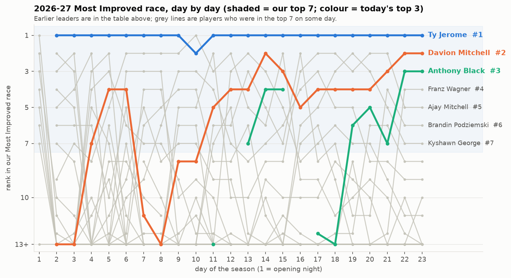

## At a glance

- **Breakouts are partly predictable:** 4–6× better than random one season ahead, in a strict walk-forward backtest.
- **For future stars, current all-round quality beats every model** (10× random), and stars arrive by two routes: a breakout season, or a steady climb.
- **"Unicorns" come in two kinds:** rare *combinations* of strengths (Giannis Antetokounmpo, Nikola Jokić) and *extremes* with no comparable players (Victor Wembanyama).
- **There are eight kinds of NBA player** by playing style, from *Mr. Inside the Key* to *The Effective Operator*. The traditional rim big fell from 23% of players to 5% since 2000; the corner 3-and-D wing rose from 4% to 20%.
- **The Most Improved Player can often be named from the box score.** Judging each season only from earlier ones, the winner was our #1 at season's end in 7 of 21 seasons and in our top 3 in 11. Voters reward production and scoring jumps and team improvement. They discount age and second-year players, and no winner in 26 years had already been an All-Star.
- **Before the season, look for the open role:** a star leaving a player's team is the strongest pre-season clue. By mid-January the winner was in our top 7 in 16 of 21 seasons.

## Contents
- [Breakouts and stars](#breakouts-and-stars)
- [Unicorns](#unicorns)
- [Eight kinds of player](#eight-kinds-of-player)
- [Most Improved Player](#most-improved-player)
- [The live 2026-27 Most Improved race](#the-live-2026-27-most-improved-race)
- [How it works](#how-it-works) · [Reproduce](#reproduce) · [Limitations](#limitations) · [What's next](#whats-next)

---

## Breakouts and stars

Strict walk-forward backtest, predictions for 2014-15 → 2024-25, players aged 25 or under ([notebooks 05–09](#how-it-works)):

| Outcome | How rare | Best model | Lift over random (95% CI) |
|---|---|---|---|
| Any breakout next season | 6.9% | Boosted trees | **4.2×** (3.3–5.3) |
| Scoring breakout next season | 4.9% | Boosted trees | **6.1×** (4.9–8.0) |
| Star season within 3 years | 1.6% | Current star score | **10×** (6.7–23) |

<details>
<summary><b>Findings, charts and Egor Dëmin</b></summary>

- **Simple is nearly as good as complex.** A 12-signal logistic regression reaches about 90% of the 197-feature model. Signals: already earning minutes, rising usage and minutes, self-creation, efficiency. Against: age, a late draft slot, already-high usage.
- **For stardom, current all-round quality beats every model.** With about 26 future stars to learn from, extra features overfit.
- **There are two routes to stardom.** Some players break out (Shai Gilgeous-Alexander, Giannis Antetokounmpo, Nikola Jokić); others climb steadily without one breakout season (Anthony Edwards, Devin Booker, Donovan Mitchell). Steady risers are visible early from current quality alone (8.6× random); breakout-route stars need trajectory signals (4.6–5.6×).
- **The models read trajectories, not single seasons.** Shai was ranked 37th of 229 young players after his rookie year, then 12th after year 2.
- **Egor Dëmin after one season:** a typical 5.3% breakout chance for 2026-27. His rookie profile most resembles Kevin Huerter, Tyler Herro, Jamal Murray and Klay Thompson: shooters who broke out more often than average but rarely became stars.

| | |
|---|---|
| 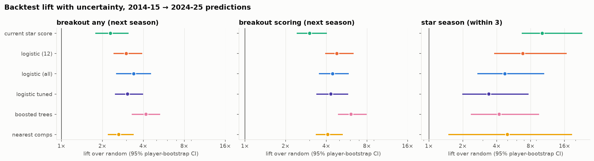 | 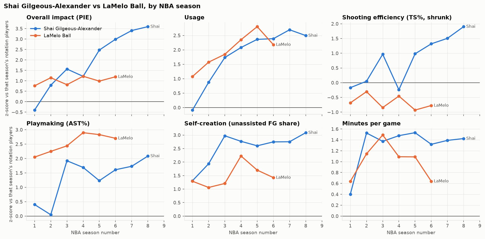 |
| Walk-forward lift over random, with bootstrap intervals | Shai Gilgeous-Alexander vs LaMelo Ball, season by season |
| 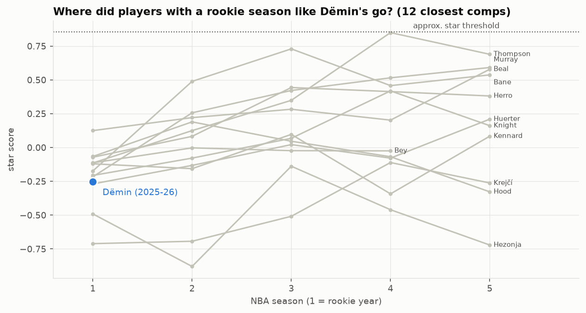 | 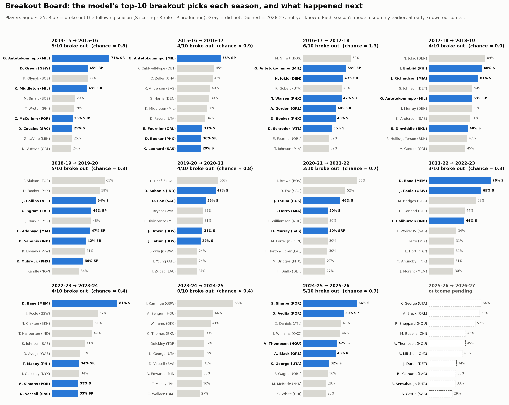 |
| Where players with a rookie season like Dëmin's went | Each season's top-10 breakout picks vs what happened |

</details>

## Unicorns

Rare *combinations* of strengths (Giannis, Jokić, Kevin Durant) versus *extremes* with no comparable players (Victor Wembanyama is the most extreme player in the data).

<details>
<summary><b>The unicorn map</b></summary>

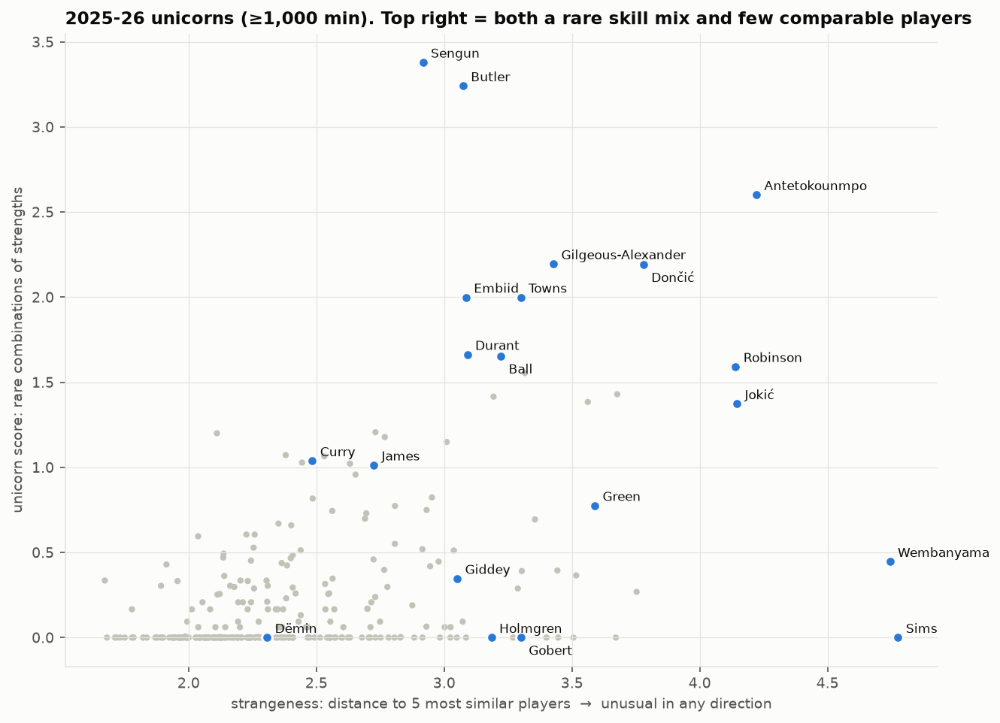

2025-26: rarity of each player's skill mix (pairs of strengths that seldom occur together) against strangeness (distance to the most similar players).

</details>

## Eight kinds of player

**How do players play, not how well?** We sorted every player-season since 2011-12 (500+ minutes) by 15 style measures: where he shoots, how he creates, rebounding and box-score defence. Each measure is compared with that season's league. No names, size or position went in, and no list of expected types was written beforehand. The data drew the groups; we named them afterwards from the players inside. Full write-up: [docs/EIGHT_CLUSTERS.md](docs/EIGHT_CLUSTERS.md).

| | Name | Best-known | What the data says |
|---|---|---|---|
| 1 | **Mr. Inside the Key** | DeAndre Jordan, Rudy Gobert, Dwight Howard | Rim shots, offensive boards, blocks; no threes |
| 2 | **Windex** | Karl-Anthony Towns ('16-17), Amen Thompson, Domantas Sabonis | Boards at both ends, paint touches; few threes |
| 3 | **Bruiser** | Al Horford, Michael Porter Jr., Brook Lopez | Defensive boards, blocks, fouls; rarely creates his own shot |
| 4 | **The Pest** | Mikal Bridges ('21-22), Josh Hart, OG Anunoby | Fast breaks, corner threes, steals; low usage |
| 5 | **Give Me the Ball and Let Me Work** | James Harden, Kevin Durant, LeBron James | Self-created makes, assists, usage; mid-range |
| 6 | **Peter Griffin's NBA Jam** | Trevor Ariza, P.J. Tucker, Toumani Camara | The most threes of any group; almost no self-creating, rim shots or free throws |
| 7 | **Kerr's Cult** | Klay Thompson, Nicolas Batum, Mikal Bridges ('24-25) | Threes and movement; few rim shots or boards |
| 8 | **The Effective Operator** | Damian Lillard, Stephen Curry, CJ McCollum | Self-created makes, assists, usage; smaller, fewest boards |

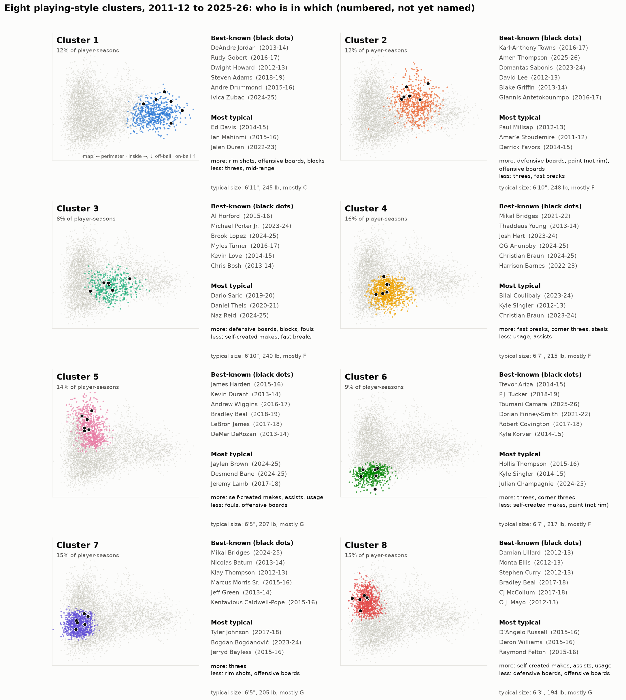

- **Players move between kinds as their game changes.** Mikal Bridges went from The Pest to Kerr's Cult. Karl-Anthony Towns started as a Windex before becoming a shooting big.
- **2025-26 surprises:** Wembanyama is a Windex, not a Bruiser: compared with the league, his rim shots and boards outweigh his threes. Draymond Green is in Kerr's Cult.

<details>
<summary><b>Back to 2000-01: how the league changed</b></summary>

The same exercise over 26 seasons, on 3-season rolling windows and with **no era adjustment**, so the league's changes show up directly ([notebook 13E](notebooks/13_archetypes.ipynb)):

- **The traditional rim big fell from 23% of players to 5%.** It was the largest group until about 2012, then collapsed by 2018.
- **The corner 3-and-D wing rose from 4% to 20%.** Bowen, Bell and Battier came first; Ariza and Tucker followed.
- **Usage-heavy and pick-and-pop bigs held steady at 6–9%,** from Garnett, Duncan and Dirk to Jokić, Giannis and Towns.

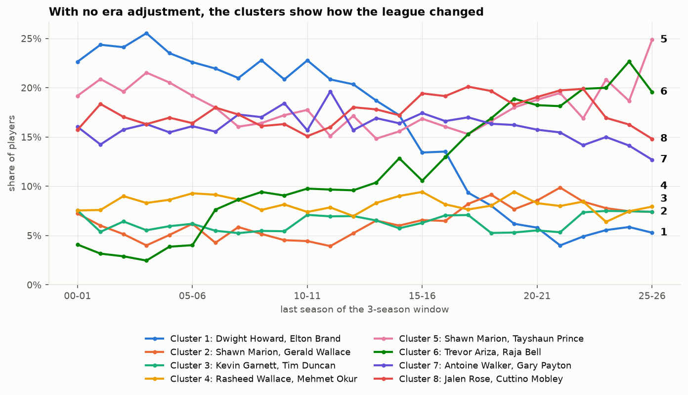

**How sure:** playing style is mostly a continuum. Five groups come back reliably when the data is split in half (0.87); eight less so (0.54 for 2011-26, 0.45 for 2000-26). We use eight because each extra split has a clear basketball reading.

</details>

## Most Improved Player

**Could we have named each Most Improved Player (MIP) from the numbers, and what do the votes say "improved" means?** ([notebook 10](notebooks/10_mip_leaps.ipynb))

| | |
|---|---|
| Winner ranked #1, from about 300 eligible players a season | **8 of 15 seasons** (median winner rank 1) |
| Same model, trained on earlier seasons only | 5 of 10 seasons |
| Using only games before the All-Star break | eventual winner already #1 in 7 of 15 |
| Our top 7 vs the real voting top 7 | 3.1 of 7 in common, on average |

<details>
<summary><b>Approach</b></summary>

- **Data:** 404,000 player-games (2010-11 → 2025-26), with Hollinger game score as the one-number measure of a game.
- **Baseline:** each player's own previous season, skipping injury-shortened ones, so a healthy return isn't counted as a leap.
- **Inputs:** the change in every box-score stat, as absolute change (ΔX) and relative change (Δ%), plus team win % change, age and a second-year flag.
- **Model:** a choice model (conditional logit). One eligible player wins each season; scores become win chances that add up to 100%. Every season is predicted by a model that never saw it. Real vote totals ([Basketball-Reference](https://www.basketball-reference.com/awards/)) are used only to evaluate, never to train.

</details>

<details>
<summary><b>What voters reward, and the winners we miss</b></summary>

- **Size beats percentage.** ΔX alone names the winner in 7 seasons; Δ% alone in 4.
- **Voters reward** a jump in all-round production (odds ×1.57 per extra point of game score), in scoring (×1.39 per extra point per game), a bigger offensive load, and a team that got better (×1.28 for winning 10% more games).
- **Voters discount** age (×0.88 per year), gains that come only from more minutes, and above all second-year players: 19% of the voting top 7, but no winner in 15 seasons (the last was Monta Ellis in 2006-07).
- **Voters skip players who are already stars.** No winner from 2000-01 to 2025-26 had been an All-Star before his winning season, and only 5 of the 105 who finished 2nd–5th had. Since 9 November this counts against a player in our models; [see why below](#why-already-an-all-star-counts-against-a-player).
- **Most winning leaps show from opening night.** For 11 of 15 winners, the first 10 games already held 80% or more of the season's jump.
- **One huge night is not a signal.** After 1,109 "eruption" games, the next seven looked like the seven before.
- **The winners the model misses crossed a milestone** rather than making the biggest jump: a first 20-ppg season (Goran Dragić), a first star-level season (Julius Randle), becoming the team's leading scorer (Tyrese Maxey, Paul George).

| | |
|---|---|
| 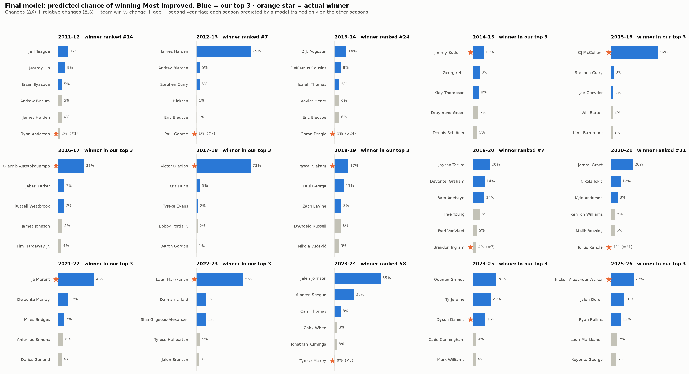 | 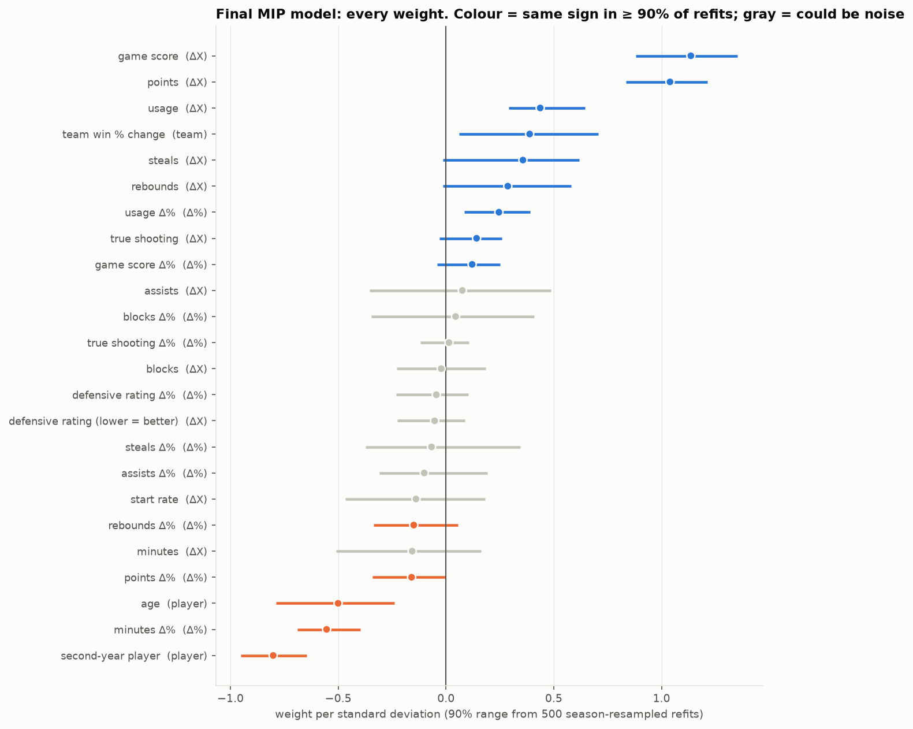 |
| Predicted chance of winning (blue = our top 3, ★ = winner) | Every model weight, with 90% ranges from 500 refits |
| 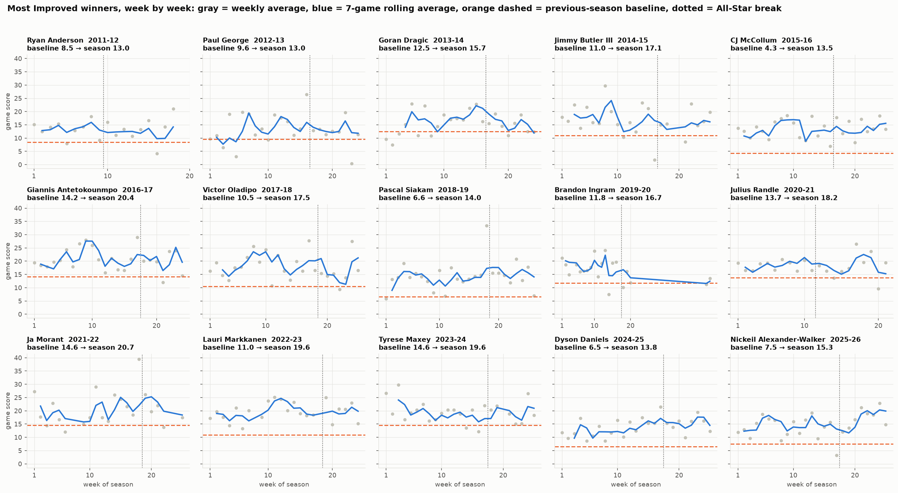 | 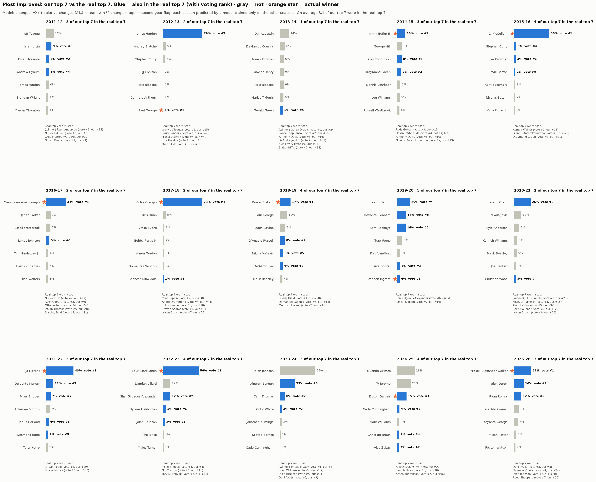 |
| Each winner's season, week by week, against his baseline | Our top 7 vs the real voting top 7 |

**Limits:** 15 winners is a small sample, and the model sees box-score changes only. Awards that turned on narrative stay partly unexplained.

**Back to 2000-01** ([notebook 15](notebooks/15_mip_2000_2026.ipynb)): 21 seasons (2005-06 → 2025-26) predicted strictly from earlier seasons only, with game logs only. The winner's median rank was **51st** at the end of the previous season, **4th** at mid-season (in our top 7 in 16 of 21) and **2nd** at the end of the season (#1 in 7, top 3 in 11).

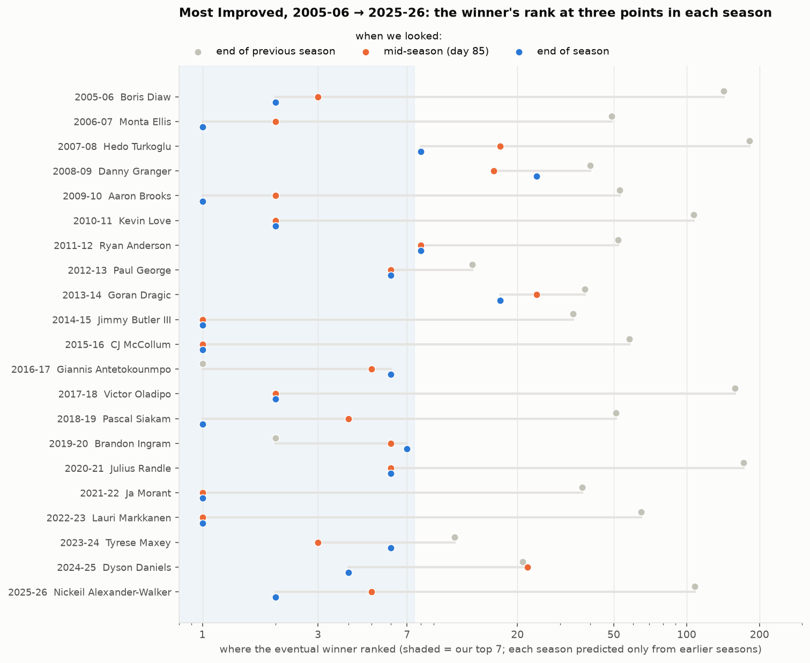

</details>

<details>
<summary><b>Predicting before the season: what preseason is worth</b> (<a href="notebooks/11_mip_preseason.ipynb">notebook 11</a>)</summary>

- **Inputs:** last season, plus preseason form per 36 minutes (never totals), shrunk for small samples.
- **What preseason is worth:** minute increases hold at about 60–75%, decreases mean almost nothing, and shot volume per minute is the most reliable preseason signal.
- **Track record:** from about 375 candidates, the eventual winner was in our preseason top 7 in 8 of 14 seasons (5 of 9 in the strict test, median rank 7) and in our top 20 in 11.
- **Backtest of the picks:** 42% of past top-7 picks jumped 3+ points a game (14% of all candidates).
- **Established scorers:** instead of excluding them, last season's scoring counts slightly in a player's favour up to a turning point and against him above it (MVP material, not MIP). Backtesting every turning point from 14 to 26 points a game, **20 fits best**.
- **A star leaving matters more than changing teams** ([notebook 14](notebooks/14_team_changes.ipynb), 21 seasons): winners changed teams no more often than anyone else (29% vs 27%), but 7 of 21 had a 20-point scorer leave their team (vs 11%). As a yes/no preseason input (star left, not replaced) it lifts the winner into our preseason top 7 in 7 of 14 seasons, up from 3.

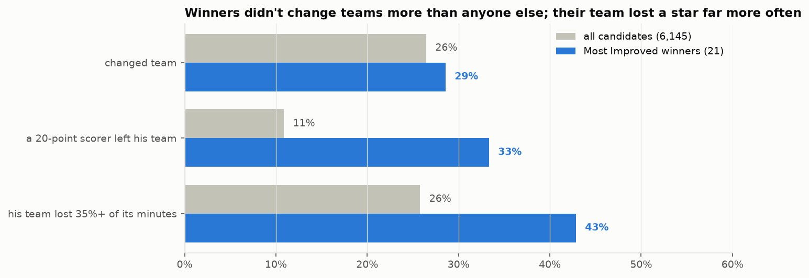

- **2026-27 top 7 (complete preseason, model as of 9 November):** Rui Hachimura, Brandon Miller, Cooper Flagg, Payton Pritchard, Tristan da Silva, Luka Garza, Derrick White. Six of the seven play for a team that lost a 20-point scorer and didn't replace him.

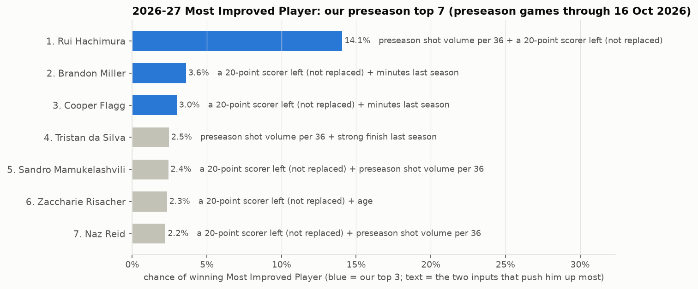

</details>

### Why "already an All-Star" counts against a player

**The problem.** In early November our live leaderboard had Alperen Sengun at #2, with Victor Wembanyama and Scottie Barnes in the top 7. All three had already been All-Stars. Our existing guard against established players, the scoring turning point, only bites above 20 points a game last season, and these players sat around or below that line.

**The evidence** ([notebook 17](notebooks/17_already_a_star.ipynb)):
- **About 1 candidate in 6 had already been an All-Star.** None of the 26 winners since 2000-01 had, and only 5 prior All-Stars finished in the top 5.
- **Without this input, our model expected them to win about 2 of those 26 awards.** If that were right, zero wins would happen about 1 time in 10: suggestive, not proof.
- **Adding it improved every test, modestly:**
  - **Preseason, strict:** the winner's median rank fell from 15 to 7, and the winner was in our top 7 in 5 of 9 seasons instead of 4.
  - **Live race at day 85:** the winner was in our top 7 in 12 of 15 seasons instead of 11.
- **Mostly, it cleans up the top 7s.** It removes stars voters were never going to pick, such as Jokić and Embiid in 2020-21, Westbrook in 2016-17 and Towns in 2024-25.

**The choice** ([decision D38](docs/DECISIONS.md)):
- **A yes/no input, not a ban.** A prior All-Star gets about **a quarter of the odds** of an otherwise identical player, so a big enough jump can still rank high. That's the same "no exclusions" stance as the scoring turning point.
- **Only selections from before the season count.** Many winners are first picked in the year they win (Paul George, Jimmy Butler, Giannis), so using that season's selection would leak the answer.
- **The data:** Basketball-Reference's All-Star pages give a list of names to check. NBA.com's own awards record, looked up by player ID, is what counts, which keeps same-name pairs like Tim Hardaway and Tim Hardaway Jr. apart.
- **Kept simple on purpose.** A count of selections, or a wider "established" measure with All-NBA and awards, adds little: no winner had been All-NBA either. More variations would mostly fit noise in 26 awards.

**What it doesn't explain:** James Harden finishing only 7th in 2012-13, and the discount on Cooper Flagg. Neither had a prior selection, so that's reputation from elsewhere, and the job of the planned sentiment trial.

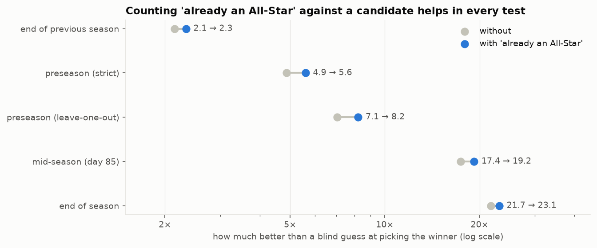

## The live 2026-27 Most Improved race

> [!TIP]
> **Last updated 8 November 2026 (day 20 of the season).** Run `./scripts/update_mip_race.sh` (or re-run [notebook 12](notebooks/12_mip_live_race.ipynb)) to add the newest days.

- **Leader:** Ty Jerome, #1 every day since his first game: 26.6 points a game in 30.5 minutes, up from 12.5 in 19.9 (about a 26% chance). He was 14th in our final preseason list. That chance is probably too high this early: past day-14 leaders averaged 19% but only 3 of 26 won, and hot starts by players aged 27+ have kept about half their jump (see [TODO](TODO.md), items 2–3).
- **Behind him:** Kyshawn George (3.4%), Ajay Mitchell, Terrence Shannon Jr, Anthony Black, Davion Mitchell, Ayo Dosunmu. Prior All-Stars Victor Wembanyama and Scottie Barnes dropped out of the top 7 when the All-Star input was added.
- **A leaderboard for every day, with no leakage.** Day *n* uses only games up to day *n*, scored by a model trained on past seasons cut at the same day. Each day is saved once and never recomputed.
- **Everyone is a candidate,** including previous winners and established scorers. A scoring turning point handles established scorers, and **the data chooses it** (none, or 16–24 points a game): it is re-chosen every day from past seasons only, then frozen at the All-Star break so the board doesn't jump late on. It has chosen 20 every day so far.

| | |
|---|---|
|  | 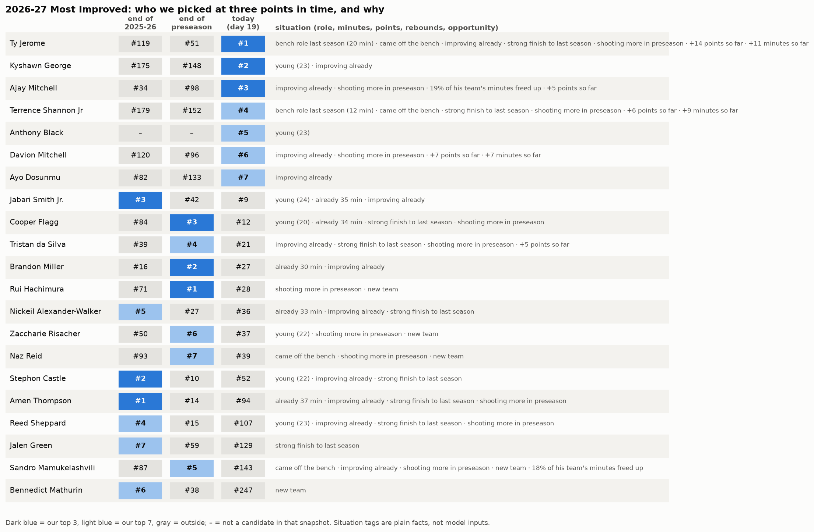 |
| Our rank for everyone who has been in the top 7, day by day | End of 2025-26 vs end of preseason vs today, with the reasons |

<details>
<summary><b>How much to trust it: backtests</b></summary>

- **How early is too early?** At day 2 the eventual winner was in our top 7 in 4 of 15 past seasons; by day 60, in 11 of 15.
- **Backtest of 2021-22 → 2025-26 (strict, earlier seasons only):** the winner was in our end-of-previous-season top 7 once, in our preseason top 7 three times, and in our mid-January top 7 in **4 of 5 seasons** (median rank 2).
- **Pre-season, a new role is the clue:** Markkanen and Daniels were traded into teams that had just lost their star, and the preseason list caught both. Alexander-Walker's and Maxey's leaps weren't visible before the season.
- **Do leaps last?** 9 of 14 past winners kept at least 80% of their jump the next season; three fell back about 4 points (Goran Dragić, Victor Oladipo, Julius Randle). Nickeil Alexander-Walker has kept all of it so far (111%, 11 games); the blip test (below) decides his case at the All-Star break.

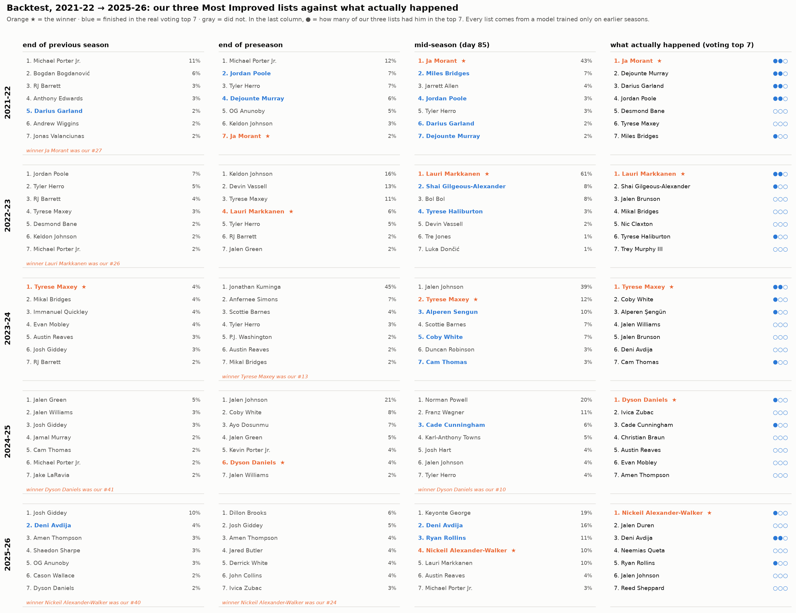

</details>

### The blip test: did Alexander-Walker's leap last?

Last season's winner, Nickeil Alexander-Walker, went from 9.4 to 20.8 points a game. Will the jump last, or was it a one-year spike?

**Why we looked at him.**
- **His leap was the one our models didn't see coming.** Before 2025-26 he was 44th on last season's numbers and 26th after preseason. Of the last five winners, his was the jump with the least warning, and those are the leaps people doubt most.
- **He's back in the race.** We decided previous winners stay in the 2026-27 pool. He sits around 35th, not because he's slipping, but because a second jump on top of the first is rare.
- **"Is it real?" kept coming up,** so we turned it into a question with an answer: **the blip test**. We wrote it down on 30 October, before the answer is known, so the verdict can't be bent to fit what happens. The alternative was judging it by eye in February, with hindsight.

| | |
|---|---|
| **When** | After his team's last game before the 2026-27 All-Star break (mid-February) |
| **Measure** | Share of his leap kept = (points a game this season − 9.4) ÷ (20.8 − 9.4) |
| **Real** | 80% or more kept, about **18.5+ points a game** |
| **Partly real** | 50–80% kept, about **15.1–18.5** |
| **Blip** | under 50% kept, under about **15.1** |
| **Not enough games** | fewer than 25 games by the break: wait for the end of the season, same cut-offs |

- **Why these lines:** they split the 14 past winners into clear groups: 9 kept 80%+ the season after (Paul George, Giannis and Siakam kept improving), 2 kept most of it (Markkanen, Daniels), and 3 fell back hard (Dragić, Oladipo, Randle).
- **Why the break is early enough:** for all 14 past winners, the verdict at the break of the season after was the same as over the full season.
- **Points per 36 minutes is shown alongside, but doesn't decide anything.** It tells "fewer minutes" apart from "scores less when he plays".
- **So far (11 games, to 8 November):** 22.1 points a game, 111% kept. On track for "real", but it's early.

**Backtest: every big leap since 2000-01** ([notebook 16](notebooks/16_do_leaps_last.ipynb)). The blip test isn't specific to him, so we ran it on 609 leaps from 2000-01 to 2024-25: every MIP vote-getter who jumped 3+ points a game, and everyone who jumped 5+, voted for or not.
- **It does what it claims:** the verdict at the break matched the full next season for **86%** of the 541 leaps with enough games. Most misses were within 10 points of a line. "Real" at the break never turned into "blip" by the end of the season.
- **Its victims are about the long run.** The test looks one season ahead, and two seasons on:
  - **About 1 blip in 5 comes back** (25 leaps). The best-known is **Julius Randle**, the 2020-21 winner: 7% kept at the next break, an All-NBA season the year after. DeMar DeRozan, Isaiah Thomas, Karl-Anthony Towns and Russell Westbrook did the same. Westbrook's leap came with Kevin Durant injured; Durant came back and Westbrook's scoring fell, then rose again when Durant left.
  - **About 1 "real" in 6 collapses later** (48 leaps), mostly through injury: Brandon Roy, Darius Garland, Isaiah Thomas after his hip injury.
- **Points per 36 is a weak hint, not a rule:** blips who kept their scoring rate came back 44% of the time, against 27% for those whose rate fell. That rests on only 18 players, so the test stays as written.
- **What a verdict means for Alexander-Walker:** "real" means the leap survived the next season, not that it's permanent. "Blip" could still turn out to be a Randle.

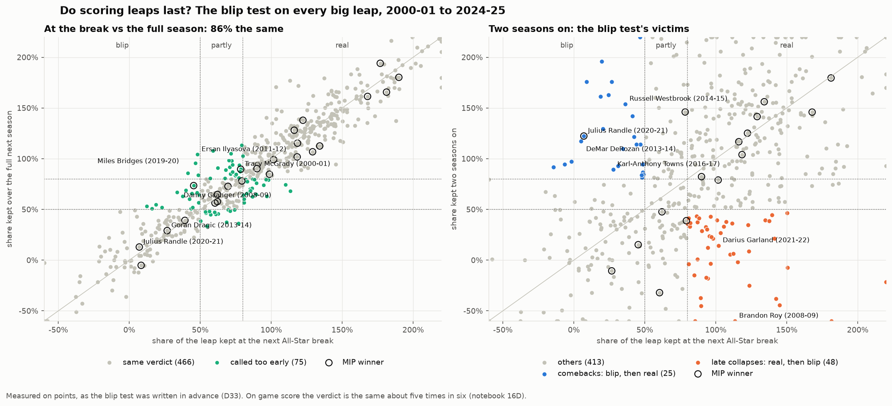

---

## How it works

| Notebook | What it does |
|---|---|
| `00`–`01` | Setup; which `nba_api` endpoints are league-wide and time-correct |
| `02_player_seasons` | 733 cached API responses → clean player-season table; shrinkage of noisy shooting %; season-relative scaling |
| `03_player_trajectories` | Level, trend and change for every feature, tested to be leakage-free |
| `04_unicorn_hunting` | Listed / body / style position spectrum; rarity and strangeness scores |
| `05_breakout_hunting` | Breakout labels relative to each player's own past; our own six-pillar star metric |
| `06_breakout_backtest` | Walk-forward backtest: rules, logistic, boosted trees, comps; intervals, calibration, sensitivity |
| `07_current_players` | 2026-27 outlook; Dëmin profile and historical comps |
| `08_breakout_board` | Each season's top-10 breakout picks vs what happened (plus an interactive page in `outputs/breakout_board.html`) |
| `09_routes_to_stardom` | Breakout route vs steady route into the star tier |
| `10_mip_leaps` | Most Improved Player: weekly leaps, the choice model, the mid-season race, our top 7 vs the real vote |
| `11_mip_preseason` | What preseason numbers are worth; a preseason top 7 for 2026-27 |
| `12_mip_live_race` | The live 2026-27 race, day by day; three snapshots with reasons; backtests; the blip test |
| `13_archetypes` | Player archetypes by playing style: how many clusters (style is a continuum; 3 and 5 are stable), five and then eight clusters, named from Mr. Inside the Key to The Effective Operator ([write-up](docs/EIGHT_CLUSTERS.md)); 2000-01 → 2025-26 on 3-season windows. Next: similar players and movement between kinds |
| `14_team_changes` | 21 seasons: does a new team or a new teammate make a Most Improved Player? (No; a star leaving his team does) |
| `15_mip_2000_2026` | Most Improved 2000-01 → 2025-26: end of previous season, mid-season and end of season, strictly walk-forward |
| `16_do_leaps_last` | Do scoring leaps last? The blip test, backtested on 609 leaps since 2000-01, and its victims |
| `17_already_a_star` | Do voters pass over players who are already stars? Prior All-Stars and the Most Improved award, 2000-26 |

**Anti-leakage rules**
- Features for season *t* use seasons ≤ *t* only; notebook 03 checks this by deleting later seasons and confirming nothing changes.
- A training example is used only once its outcome was known at prediction time.
- Preprocessing is fitted inside each fold, and model settings (like the scoring turning point) are chosen from earlier seasons only.
- Award votes are used only to score predictions, never to train.
- Live-race leaderboards are saved the day they are made and never recomputed; rules like the blip test are written down before the answer is known.

Every significant choice, with its evidence, is logged in [docs/DECISIONS.md](docs/DECISIONS.md) (38 decisions).

<details>
<summary><b>Data traps found along the way</b></summary>

- NBA.com's `PlayerIndex` returns *current* heights and positions for past seasons (a leakage trap).
- The 2019 switch to measured heights made 56% of players shorter overnight.
- The bio endpoint gives some players the wrong draft record.
- NBA.com's PIE rating over-represents big men among "stars" about 2×.

</details>

## Reproduce

```bash
git clone https://github.com/dan-j-e/unicorn-hunting.git && cd unicorn-hunting
python -m venv .venv && source .venv/bin/activate
pip install -r requirements.txt
pip install -e .                 # makes `import unicorn` available
python -m unicorn.download       # ~733 NBA.com requests, ~40 min first time, resumable
```

Then run the notebooks in order (`00` → `16`). Each writes the table the next one reads. Raw responses are cached in `data/raw/`, so re-runs make no API calls. Notebook 10 also fetches 16 seasons of game logs and the Basketball-Reference award pages; notebooks 13E, 15 and 16 go back to 1998-99 (all cached). **To update the live Most Improved race:** `./scripts/update_mip_race.sh` re-runs notebook 12 with the newest games and prints today's top 7. There is also a local Streamlit dashboard (parked) for changing the star-score weights and breakout thresholds: `streamlit run dashboard/app.py`.

<details>
<summary><b>Project structure</b></summary>

```
notebooks/        numbered research pipeline (00 → 16), saved with outputs
src/unicorn/      reusable code
  raw, download            cached NBA.com access and the full download list
  player_season, columns   clean tables and the data dictionary
  features, trajectories   shrinkage, season-relative scaling, leakage-safe trends
  position, unicorn        position spectrum and unicorn scores
  labels, backtest, comps  breakout/star labels, walk-forward engine, comparables
  gamelogs, mip, bref      game-level data, the Most Improved model, voting results
  preseason                preseason game logs and the pre-opening-night view of each player
  mip_history, leaps       Most Improved 2000-26 backtest; the blip test
  archetypes, style_history  playing-style clusters; 3-season style windows 2000-26
  board, stats, plotting   breakout board, statistics helpers, chart style
scripts/          update_mip_race.sh: refresh the live race in one command
dashboard/app.py  Streamlit app (parked)
docs/DECISIONS.md decision log
docs/EIGHT_CLUSTERS.md the eight kinds of player, written up
outputs/          figures and tables
data/             raw and processed data (git-ignored, rebuilt from code)
```

</details>

## Limitations
- **Box-score data only** (NBA.com). No play-by-play, lineups, injuries, contracts or scouting; on-court net rating mixes player and team quality.
- **Few positive cases:** about 26 future stars, 28 production breakouts and 15 MIP winners in the full model (26 in the game-log version), so those results have wide intervals.
- **Voters aren't only box-score readers.** Reputation and narrative (an established star, a good story) aren't in the model yet; see the [TODO](TODO.md).
- **"Star" is our own definition** (six equally weighted pillars); one-dimensional scorers rarely qualify, by design.
- **One rookie season is thin evidence.** Predictions for second-year players are far better informed than for rookies.

## What's next
See [TODO.md](TODO.md): making the Most Improved model fit how voters behave (hot starts, honest early-season chances, a sentiment trial), then "who is similar to who", how players move between the eight kinds, and explained picks.
