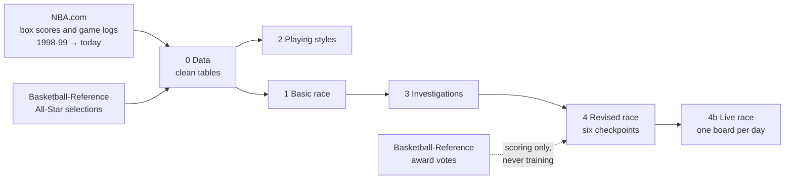
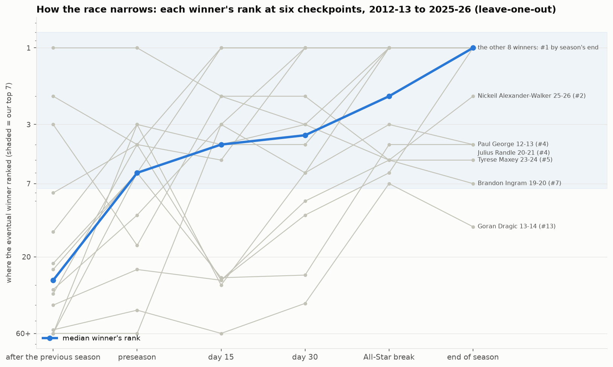
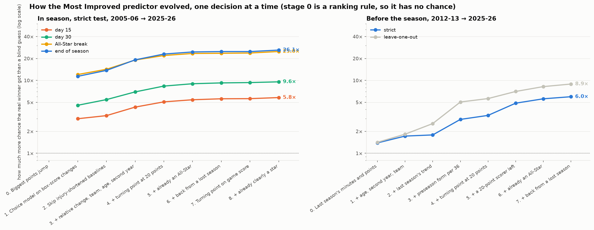

# NBA Unicorn & Breakout Hunting


**Could we have named the NBA's Most Improved Player, and seen what kind of player someone is, before it became obvious, using only what was known at the time?**

The project treats scouting like backtesting an investment strategy. For every past season it rebuilds what was knowable at that moment, ranks the players, and scores the ranking against what actually happened. Only a method that passes that test is applied to the current season.

> [!NOTE]
> **Live: the 2026-27 Most Improved race.** Ty Jerome leads with a 12.3% chance on 11 November (day 22 after opening night), ahead of Davion Mitchell and Anthony Black. The model is frozen for the season, so 2026-27 is its first clean test ([the live race](#4b--the-live-race)).


## The project in four segments

| | Segment | Question | Notebook |
|---|---|---|---|
| 0 | [Data](#0--data) | Which NBA.com data can be trusted for its time? | [0_data](notebooks/0_data.ipynb) |
| 1 | [The basic Most Improved race](#1--the-basic-most-improved-race) | Can a simple model name the winner from the box score, and what do voters reward? | [1_mip_basic](notebooks/1_mip_basic.ipynb) |
| 2 | [Playing styles](#2--playing-styles-eight-kinds-of-player) | What kinds of player are there, by *how* they play? | [2_play_styles](notebooks/2_play_styles.ipynb) |
| 3 | [Candidate investigations](#3--most-improved-candidate-investigations) | When a name on the board looked wrong, what did the evidence say? | [3_mip_investigations](notebooks/3_mip_investigations.ipynb) |
| 4 | [The revised race](#4--the-revised-most-improved-race) | How good is the model at each point of a season, and can its chances be trusted? | [4_mip_race](notebooks/4_mip_race.ipynb) |
| 4b | [The live race](#4b--the-live-race) | Who leads 2026-27, day by day? | [4b_live_race](notebooks/4b_live_race.ipynb) |

Every notebook opens with **In brief** (question, answer, decisions, where it fits) and closes with dated **findings**, so reading those blocks gives the whole story. The [terms](#terms-used-throughout) are defined once, below. The 23 original notebooks, with every intermediate step, are in [notebooks/archive](notebooks/archive).



Every arrow runs forward in time: a prediction for a season uses only seasons, games and selections that came before it, and award votes are used only to mark predictions, never to train a model.

---

## 0 — Data

**Seven clean tables, all rebuilt from an unchanged cache of NBA.com responses** ([notebook 0](notebooks/0_data.ipynb)): 7,889 player-seasons (2011-12 → 2025-26), 404,431 player-games (673,732 back to 1999-00), and 900 earlier All-Star selections, matched by player ID.

- **Several sources look right but are not correct for their time.** `PlayerIndex` returns today's values for any season; career totals include later seasons; the bio endpoint gives some players a wrong draft record; the 2019-20 switch to measured heights made 56% of players shorter overnight. Each is avoided.
- **Shooting percentages are shrunk** towards the season-and-position average by the number of attempts, which cuts next-season prediction error by 29–53% ([D11](docs/DECISIONS.md)).
- **Every measure is also compared within its season**, because the league changed: a 35% three-point share was at the 69th percentile in 2011-12 and the 31st in 2025-26 ([D12](docs/DECISIONS.md)).
- **The trajectory columns pass a leakage test:** deleting every later season changes nothing.

## 1 — The basic Most Improved race

**Can the Most Improved Player (MIP) be named from the box score, and what does "improved" mean to voters?** ([notebook 1](notebooks/1_mip_basic.ipynb))

Each player is compared with his **baseline season**: his most recent season covering at least a third of the games, so a healthy return from injury is not a leap ([D22](docs/DECISIONS.md)). The model is a **choice model** (conditional logit): one winner per season, so every candidate's score becomes a share of a single 100% chance ([D24](docs/DECISIONS.md)):

$$
P(\text{player } i \text{ wins season } s) \;=\; \frac{\exp\!\left(x_i^{\top}\beta\right)}{\sum_{j \,\in\, \text{candidates}(s)} \exp\!\left(x_j^{\top}\beta\right)}
$$

with a penalty λ = 3 on the weights ([D30](docs/DECISIONS.md)).

- **Most leaps show early, with a new role.** 9 of 15 winners had 80% or more of their leap in their first 10 games. One huge night says little: after 1,089 "eruptions", the next 7 games looked like the 7 before.
- **The biggest points jump alone names the winner 4 times in 15.** It often picks a bench player handed minutes.
- **The basic model names him 8 times in 15** (top 3 in 9, median rank 1); **5 of 10** in the strict test. On average 3.1 of our top 7 were in the real voting top 7.
- **Voters reward** a jump in game score (odds ×1.57 per extra point of game score a game) and in points (×1.39 per point), more usage, and a team that wins more (×1.28 per 10% more wins). **They mark down** age (×0.88 per year), jumps that come only from more minutes, and above all second-year players (×0.08: 0 of 15 winners).
- **The winners it misses crossed a milestone:** a first 20-point season (60% of winners, 2.3% of candidates), a first star-tier season, or becoming the team's leading scorer (Goran Dragić, Julius Randle, Tyrese Maxey, Paul George).

| | |
|---|---|
|  |  |
| Every weight, with its 90% range from 500 refits | Each winner's season, week by week, against his baseline |

## 2 — Playing styles: eight kinds of player

**What kinds of player are there, judged by how they play rather than how well?** ([notebook 2](notebooks/2_play_styles.ipynb); write-up: [the eight kinds of player](docs/EIGHT_CLUSTERS.md))

15 style measures (where he shoots, how he creates, how he rebounds, his box-score defence), each compared within its season, for every player-season with 500+ minutes since 2011-12 (5,353). **The data drew the groups; we named them afterwards:** no expected types and no names were written first ([D31](docs/DECISIONS.md)).

| | Kind | Share | Best-known members | Does more / less |
|---|---|---|---|---|
| 1 | **Mr. Inside the Key** | 12% | DeAndre Jordan, Rudy Gobert, Dwight Howard | Rim shots, offensive boards, blocks / threes |
| 2 | **Windex** | 12% | Karl-Anthony Towns, Amen Thompson, Domantas Sabonis | Boards at both ends, paint / threes |
| 3 | **Bruiser** | 8% | Al Horford, Michael Porter Jr., Brook Lopez | Defensive boards, blocks, fouls / self-created shots |
| 4 | **The Pest** | 16% | Mikal Bridges, Josh Hart, OG Anunoby | Fast breaks, corner threes, steals / usage |
| 5 | **Give Me the Ball and Let Me Work** | 14% | James Harden, Kevin Durant, Andrew Wiggins | Self-created shots, assists, usage |
| 6 | **Peter Griffin's NBA Jam** | 9% | Trevor Ariza, P.J. Tucker, Toumani Camara | Threes, corner threes / self-creation |
| 7 | **Kerr's Cult** | 15% | Klay Thompson, Nicolas Batum, Mikal Bridges | Threes / rim shots, boards |
| 8 | **The Effective Operator** | 15% | Damian Lillard, Stephen Curry, Monta Ellis | Self-created shots, assists; smaller, fewer boards |


- **Style is a continuum, not islands.** Two random halves of the data agree on three groups 94% of the time, on five 83%, on six 79%, and on eight only 54%. Eight were chosen ([D35](docs/DECISIONS.md)) because they fit neatly inside the five and each split has a basketball reading.
- **Players move between kinds:** Mikal Bridges from The Pest to Kerr's Cult; Brook Lopez from Windex to Bruiser. In 2025-26, Wembanyama, Jokić and Giannis are Windex; Draymond Green is in Kerr's Cult.
- **Over 2000-26, with no era adjustment,** the traditional rim big fell from 23% of players to 5%, and the corner 3-and-D wing rose from 4% to 20% ([D36](docs/DECISIONS.md)).


## 3 — Most Improved candidate investigations

**When a name on the live board looked wrong, what did the evidence say, and what did it change?** ([notebook 3](notebooks/3_mip_investigations.ipynb)) A name can raise a question; only a test across past seasons answers it, with the rule for deciding written first.

| Case | Raised by | Evidence | Decision |
|---|---|---|---|
| **3A Did the leap last?** | Nickeil Alexander-Walker, last season's winner | The blip test, set in advance, matches the full season on 86% of 541 past leaps | Rule fixed before the answer ([D33](docs/DECISIONS.md)); 110% kept so far, verdict at the All-Star break |
| **3B Is the lead believable?** | Ty Jerome, 26% on 8 November | No player 27+ had started this hot; 14 lookalikes kept 65% of their jump and none won | "Back from a lost season" counts against a candidate: it improved all 10 tests ([D39](docs/DECISIONS.md)); Jerome 26.5% → 8.3% |
| **3C Already a star?** | Alperen Sengun, Victor Wembanyama, Cooper Flagg | 0 of 26 winners had been All-Stars, against 2.2–2.5 expected; none of 75 elite-baseline candidates finished top 5 | "Already an All-Star" ([D38](docs/DECISIONS.md)) and "already clearly a star" ([D42](docs/DECISIONS.md)) count against a candidate |
| **3D An open role?** | Rui Hachimura, top of the preseason list | Winners changed teams no more often (36% against 34%), but 43% had a 20-point scorer leave, against 8% | "A 20-point scorer left" ([D29](docs/DECISIONS.md)), kept on points ([D43](docs/DECISIONS.md)) |

Three of these changes were prompted by names on the board, which is why the model is now frozen for the season ([D44](docs/DECISIONS.md)).

| | |
|---|---|
|  |  |
| Everyone up 8+ points a game at day 19, 2000-01 → 2025-26 | The blip test on every big leap since 2000-01 |

## 4 — The revised Most Improved race

**How good is the model at each point of a season, how did it get here, and can its chances be trusted?** ([notebook 4](notebooks/4_mip_race.ipynb))

**Six checkpoints** ([D48](docs/DECISIONS.md)), strict test (each season predicted from earlier seasons only):

| Checkpoint | Seasons | Winner #1 | In our top 7 | Median rank | × a blind guess |
|---|---|---|---|---|---|
| After the previous season | 9 | 1 | 2 | 40 | 2.8× |
| Preseason | 9 | 1 | 5 | 7 | 6.0× |
| Day 15 | 21 | 1 | 11 | 7 | 5.7× |
| Day 30 | 21 | 2 | 12 | 6 | 9.4× |
| **All-Star break** | 21 | 6 | **19** | **3** | **24.4×** |
| End of season | 21 | 8 | 17 | 2 | 25.6× |



- **Before the season, the model finds players set up to improve, not the winner.** Last season alone cannot see the summer's moves; preseason form and an open role lift the winner to a median rank of 7.
- **The first month is a rough shortlist; by the All-Star break the race is essentially decided:** the winner is in our top 7 in 19 of 21 seasons, as reliably as at season's end.
- **It got here one decision at a time.** At season's end it went from 11.4× to 26.1× a blind guess over eight decisions; the biggest step was understanding voters (relative change, team, age, second year). The latest steps are small, so the model is frozen.
- **The chances are honest** (players given 3–10% won 6.5–8.0% of the time), **except for big early favourites:** 19 players given 25%+ in the first month were expected to win 7.5 times and won 3. They are flagged, not corrected ([D40](docs/DECISIONS.md)).
- **The turning point** (established players are MVP material, not Most Improved) is on game score in season and on points before it ([D27](docs/DECISIONS.md), [D41](docs/DECISIONS.md)): the two correlate at 0.955, so voters discount *established* players however it is measured.



> [!NOTE]
> **These scores flatter the model somewhat.** Each season is predicted from earlier seasons, but λ, the elite threshold and the later inputs were chosen by looking at these same seasons. The large early gains hold up when the seasons are resampled ([Audit 2](docs/AUDIT.md)); the small late ones may not. 2026-27, with the model frozen, is the first clean test.

## 4b — The live race

**The 2026-27 race, one leaderboard per day** ([notebook 4b](notebooks/4b_live_race.ipynb)). Day *n* uses only games up to day *n*, scored by a model trained on past seasons cut at the same day. Each day is saved once and never recomputed, and a night's games count only once it is over (4 a.m. US Eastern).

| Rank | Player | Chance (11 November) | Points a game (baseline season) |
|---|---|---|---|
| 1 | **Ty Jerome** | 12.3% | 26.2 (12.5) |
| 2 | Davion Mitchell | 6.3% | 16.5 (9.3) |
| 3 | Anthony Black | 6.3% | 17.8 (15.0) |
| 4 | Franz Wagner | 5.7% | 23.5 (20.6) |
| 5 | Ajay Mitchell | 3.3% | 18.5 (13.6) |
| 6 | Brandin Podziemski | 3.0% | 17.0 (13.8) |
| 7 | Kyshawn George | 2.7% | 18.5 (14.8) |

*Points are shown for readability; the model uses the change in every box-score statistic.* Before the season the list was led by Rui Hachimura (now #35); established stars dropped back once "already clearly a star" was added (Cooper Flagg #10, Wembanyama #17). **The model is frozen until the season ends** ([D44](docs/DECISIONS.md)); betting markets are recorded weekly as a benchmark, never an input ([D45](docs/DECISIONS.md)). Update with `./scripts/update_mip_race.sh` (about 20 seconds).

---

## Archived: breakouts, stars and unicorns

The project began with breakouts and stars; that work is complete and archived ([D47](docs/DECISIONS.md)), in [notebooks/archive](notebooks/archive) (04–09). Strict walk-forward backtest, players aged 25 or under, predictions for 2014-15 → 2024-25:

| Outcome | How rare | Best model | Lift over random (95% CI) |
|---|---|---|---|
| Any breakout next season | 6.9% | Boosted trees | 4.2× (3.3–5.3) |
| Scoring breakout next season | 4.9% | Boosted trees | 6.1× (4.9–8.0) |
| Star season within 3 years | 1.6% | Current star score | 10× (6.7–23) |

"Best model" is the best of six to eight compared on the same backtest, so these lifts are slightly optimistic. For stardom, current all-round quality beat every model; there are two routes to stardom (a breakout, or a steady climb). **Unicorns** come in two kinds: rare *combinations* of strengths (Giannis, Jokić) and *extremes* with no comparable players (Wembanyama).

---

## How it works

### Terms used throughout

| Term | Meaning |
|---|---|
| **Strict test** (walk-forward) | Each season is predicted by a model trained only on *earlier* seasons, as it could have been at the time. The test we trust most. |
| **Leave-one-out** | Each season is predicted from every *other* season, later ones included: steadier, but kinder. Both are reported. |
| **× a blind guess** | How much more chance the model gave the real winner than an even split across every candidate (geometric mean over seasons). 1× is no better than guessing. |
| **Day *N*** | Days after opening night: opening night is day 0, day 30 is about a month in. |
| **Baseline season** | A player's most recent earlier season covering at least a third of the games ([D22](docs/DECISIONS.md)). |
| **Choice model** | Conditional logit: every candidate competes for one award, so the chances add up to 100% ([D24](docs/DECISIONS.md)). Penalty λ = 3 ([D30](docs/DECISIONS.md)). |
| **Turning point** | Last season's level counts for a candidate up to a point and against him above it: 20 points a game before the season ([D27](docs/DECISIONS.md)); game score 14–15.5, chosen by the data each day, in season ([D32](docs/DECISIONS.md), [D41](docs/DECISIONS.md)). |
| **Already an All-Star / already clearly a star / back from a lost season** | Inputs that count against a candidate ([D38](docs/DECISIONS.md), [D42](docs/DECISIONS.md), [D39](docs/DECISIONS.md)). |
| **The blip test** | The share of a scoring leap kept at the next All-Star break: 80%+ real, 50–80% partly real, under 50% a blip ([D33](docs/DECISIONS.md)). |
| **Game score** | One number for a box-score line: points, rebounds, assists, steals and blocks, less missed shots, turnovers and fouls. About 10 is an average game. |
| **Season-relative** | A measure compared with that season's rotation players (500+ minutes), in standard deviations. |
| **Shrinkage** | Pulling a small-sample percentage towards the average, by an amount set by the attempts ([D11](docs/DECISIONS.md)). |
| **Star score, star tier** | Our own six-part all-round measure, half-adjusted for body size; the star tier is each season's top 10% ([D17](docs/DECISIONS.md), [D21](docs/DECISIONS.md)). A *star season* (archived breakout work) is the top 5%. |

> [!IMPORTANT]
> **Anti-leakage rules.** Every result above follows these.
> - Inputs for season *t* use seasons up to *t* only; notebook 0 checks this by deleting later seasons and confirming that nothing changes.
> - A training example is used only once its outcome was known at prediction time; settings such as the live race's turning point are chosen inside each training window.
> - Award votes are used only to mark predictions, never to train.
> - Live leaderboards are saved on the day and never recomputed; rules such as the blip test are written down before the answer is known.

### Key decisions

All 48 decisions, each with its evidence, are in [docs/DECISIONS.md](docs/DECISIONS.md); the audits are in [docs/AUDIT.md](docs/AUDIT.md). The ones that most shape the results:

| # | Decision | Why |
|---|---|---|
| D22 | Skip injury-shortened baseline seasons | Comebacks looked like leaps against a 9-game season |
| D24 | A choice model with one winner per season | The award has exactly one winner |
| D27, D41 | Established players handled by a turning point, not excluded; in season on game score | Keeps every player in the pool; voters discount established players, however measured |
| D29 | "A 20-point scorer left" as a preseason input | 43% of winners against 8% of candidates; finer bands fitted noise |
| D31, D35 | No expected archetypes written first; eight playing-style clusters | Avoids forcing players into types we already believe in |
| D33 | The blip test written down before the answer is known | The verdict cannot be bent with hindsight |
| D38, D39, D42 | Already an All-Star, back from a lost season, already clearly a star count against a candidate | 0 of 26 winners in each position; each improved the tests |
| D40 | No recalibration; big early favourites flagged | Chances are honest on the whole; the exception rests on 19 cases |
| D44, D45 | The live model frozen for 2026-27; markets a benchmark only | A genuine out-of-sample season; no copying the market |
| D47, D48 | One notebook per segment; six checkpoints | A project a reader can follow; the points people talk about a season |

### Reproduce

```bash
git clone https://github.com/dan-j-e/unicorn-hunting.git && cd unicorn-hunting
python -m venv .venv && source .venv/bin/activate
pip install -r requirements.txt
pip install -e .                 # makes `import unicorn` available
python -m unicorn.download       # about 733 NBA.com requests; 40 minutes the first time; resumable
```

Then run `0_data` first: it builds every table the other notebooks read. After that the segment notebooks run in any order (`4_mip_race` takes about 15 minutes). Raw responses are cached in `data/raw/`, so re-runs make no API calls. **To update the live race:** `./scripts/update_mip_race.sh` re-runs notebook 4b with the newest games and prints today's top 7.

<details>
<summary><b>Project structure</b></summary>

```
notebooks/        one notebook per segment (0_data → 4b_live_race), saved with outputs
  archive/        the 23 original notebooks (00-22): every intermediate step
src/unicorn/      shared code
  raw, download              cached NBA.com access and the full download list
  player_season, columns     clean tables and the data dictionary
  features, trajectories     shrinkage, season-relative scaling, leakage-safe trends
  position, unicorn, labels  position spectrum, unicorn and star scores, breakout labels
  gamelogs, mip, bref        game-level data, the choice model, voting results
  preseason, mip_history     the preseason view of each player; the 2000-26 frames
  mip_eval, live_race        how every Most Improved model is scored; the live race's candidates
  allstars, hot_start,       already an All-Star, back from a lost season,
  established                already clearly a star
  leaps, calibration         the blip test; out-of-sample scores
  archetypes, style_history  playing-style clusters; 3-season style windows 2000-26
  backtest, comps, board     archived breakout work
  stats, plotting            statistics helpers, chart style
scripts/          update_mip_race.sh (the live race in one command); audit_gains.py (are the model's gains real?)
benchmarks/       weekly betting-market snapshots (never a model input)
docs/             DECISIONS.md, AUDIT.md, EIGHT_CLUSTERS.md
outputs/          figures and tables
data/             raw and processed data (not in git; rebuilt from code)
```

</details>

## Limitations

> [!CAUTION]
> - **Box-score data only.** No play-by-play, lineup, injury, contract or scouting data.
> - **The Most Improved scores are partly in-sample** (see segment 4); 2026-27 is the first clean test.
> - **Few positive cases.** 15–26 Most Improved winners, depending on the period, mean wide uncertainty around every result.
> - **Voters are not only box-score readers.** Reputation and narrative (Harden finishing 7th in 2012-13) are not in the model.
> - **Big early favourites are over-rated;** the live race flags them.

## What's next

The full plan is in [TODO.md](TODO.md).

- [x] Restructure into one notebook per segment ([D47](docs/DECISIONS.md)); points per game kept as the illustration, not the model ([D46](docs/DECISIONS.md))
- [ ] Tests and automatic checks on every pull request
- [ ] Value or reputation? Our own measure of what a player is worth, against what a casual fan sees
- [ ] Similar players at the same career stage, and how their careers turned out
- [ ] Track the 2026-27 breakout predictions (from January)
- [ ] Does changing your game pay off? Moves between the eight kinds
- [ ] A live site on GitHub Pages
- [ ] When the model reopens (2027-28): one package of improvements, tested once ([D46](docs/DECISIONS.md))
