# NBA Unicorn & Breakout Hunting

**Could we have spotted future NBA breakouts, stars and "unicorns" before they became obvious, using only what was known at the time?**

Scouting treated like backtesting an investment strategy: for every season since 2011-12, rebuild what was knowable then, rank players, and score the rankings against what actually happened. Only then apply the method to today's players.

> [!NOTE]
> **Live: the 2026-27 Most Improved race.** Ty Jerome has led every day since his first game (about a 46% chance as of 28 October, day 9 of the season). [Jump to the race ↓](#the-live-2026-27-most-improved-race)

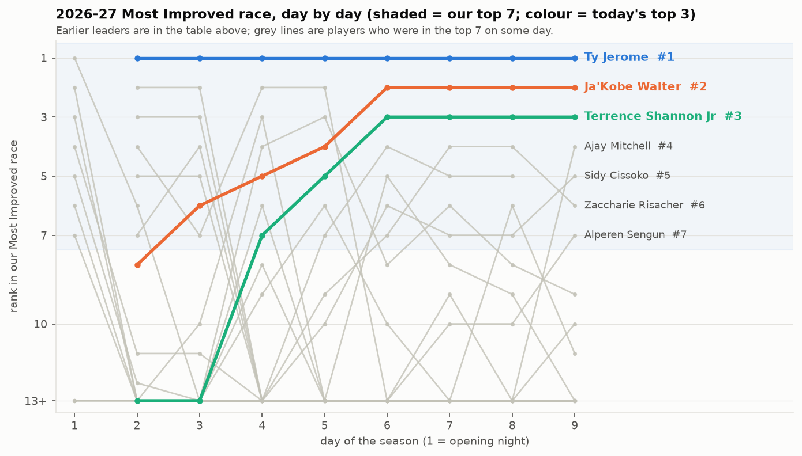

## At a glance

- **Breakouts are partly predictable:** 4–6× better than random one season ahead, in a strict walk-forward backtest.
- **For future stars, current all-round quality beats every model** (10× random), and stars arrive by two routes: a breakout season, or a steady climb.
- **"Unicorns" come in two kinds:** rare *combinations* of strengths (Giannis Antetokounmpo, Nikola Jokić) and *extremes* with no comparable players (Victor Wembanyama).
- **The Most Improved Player can be named from the box score** in 8 of 15 seasons. Voters reward production and scoring jumps and team improvement, and discount age and second-year players.
- **Before the season, nobody knows:** pre-season lists rarely contain the eventual winner, but by mid-January the winner was in our top 7 in 4 of the last 5 seasons.

## Contents
- [Breakouts and stars](#breakouts-and-stars)
- [Unicorns](#unicorns)
- [Most Improved Player](#most-improved-player)
- [The live 2026-27 Most Improved race](#the-live-2026-27-most-improved-race)
- [How it works](#how-it-works) · [Reproduce](#reproduce) · [Limitations](#limitations) · [What's next](#whats-next)

---

## Breakouts and stars

Strict walk-forward backtest, predictions for 2014-15 → 2024-25, players aged 25 or under ([notebooks 05–09](#how-it-works)):

| Outcome | How rare | Best model | Lift over random (95% CI) |
|---|---|---|---|
| Any breakout next season | 6.9% | Boosted trees | **4.2×** (3.3–5.3) |
| Scoring breakout next season | 4.9% | Boosted trees | **6.1×** (4.9–8.0) |
| Star season within 3 years | 1.6% | Current star score | **10×** (6.7–23) |

<details>
<summary><b>Findings, charts and Egor Dëmin</b></summary>

- **Simple is nearly as good as complex.** A 12-signal logistic regression reaches about 90% of the 197-feature model. Signals: already earning minutes, rising usage and minutes, self-creation, efficiency. Against: age, a late draft slot, already-high usage.
- **For stardom, current all-round quality beats every model.** With about 26 future stars to learn from, extra features overfit.
- **There are two routes to stardom.** Some players break out (Shai Gilgeous-Alexander, Giannis Antetokounmpo, Nikola Jokić); others climb steadily without one breakout season (Anthony Edwards, Devin Booker, Donovan Mitchell). Steady risers are visible early from current quality alone (8.6× random); breakout-route stars need trajectory signals (4.6–5.6×).
- **The models read trajectories, not single seasons.** Shai was ranked 37th of 229 young players after his rookie year, then 12th after year 2.
- **Egor Dëmin after one season:** a typical 5.3% breakout chance for 2026-27. His rookie profile most resembles Kevin Huerter, Tyler Herro, Jamal Murray and Klay Thompson: shooters who broke out more often than average but rarely became stars.

| | |
|---|---|
| 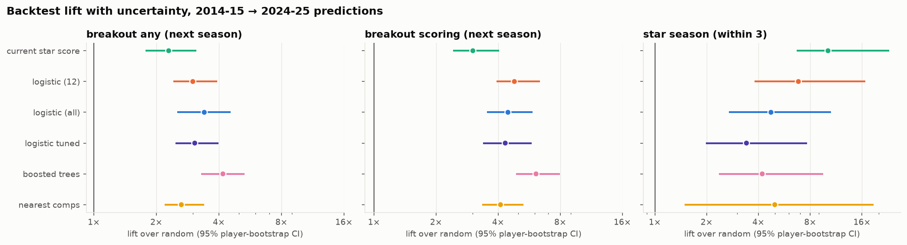 | 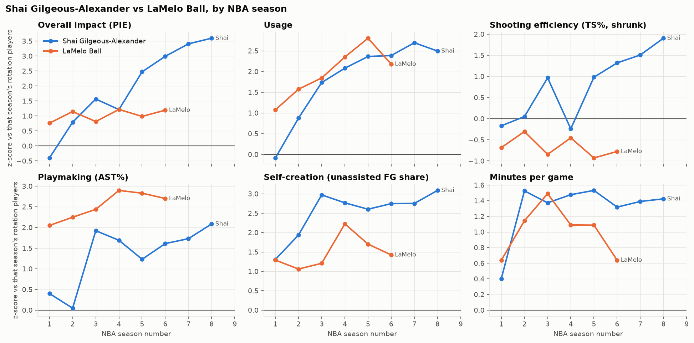 |
| Walk-forward lift over random, with bootstrap intervals | Shai Gilgeous-Alexander vs LaMelo Ball, season by season |
| 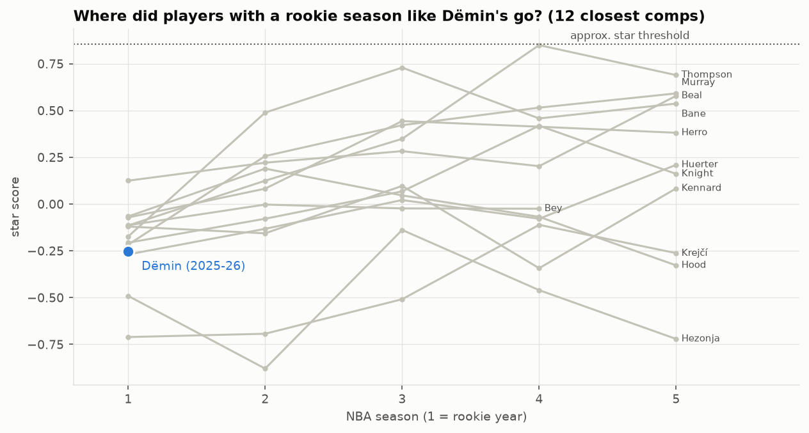 | 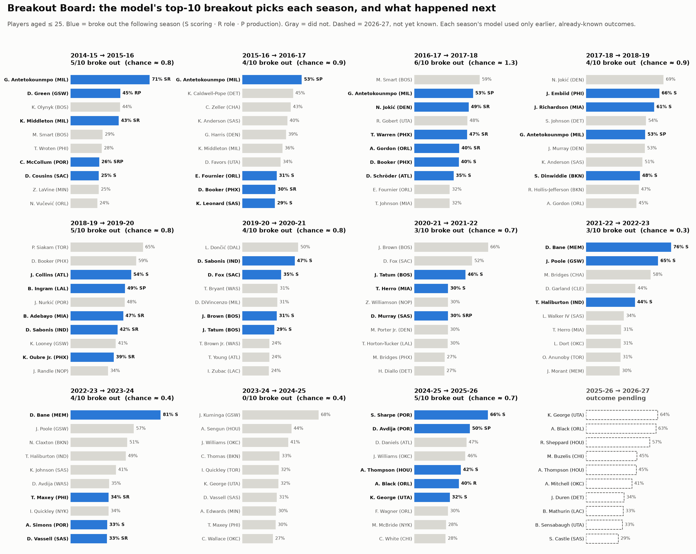 |
| Where players with a rookie season like Dëmin's went | Each season's top-10 breakout picks vs what happened |

</details>

## Unicorns

Rare *combinations* of strengths (Giannis, Jokić, Kevin Durant) versus *extremes* with no comparable players (Victor Wembanyama is the most extreme player in the data).

<details>
<summary><b>The unicorn map</b></summary>

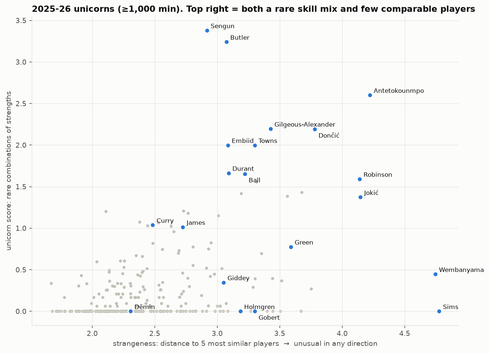

2025-26: rarity of each player's skill mix (pairs of strengths that seldom occur together) against strangeness (distance to the most similar players).

</details>

## Most Improved Player

**Could we have named each Most Improved Player (MIP) from the numbers, and what do the votes say "improved" means?** ([notebook 10](notebooks/10_mip_leaps.ipynb))

| | |
|---|---|
| Winner ranked #1, from about 300 eligible players a season | **8 of 15 seasons** (median winner rank 1) |
| Same model, trained on earlier seasons only | 5 of 10 seasons |
| Using only games before the All-Star break | eventual winner already #1 in 7 of 15 |
| Our top 7 vs the real voting top 7 | 3.1 of 7 in common, on average |

<details>
<summary><b>Approach</b></summary>

- **Data:** 404,000 player-games (2010-11 → 2025-26), with Hollinger game score as the one-number measure of a game.
- **Baseline:** each player's own previous season, skipping injury-shortened ones, so a healthy return isn't counted as a leap.
- **Inputs:** the change in every box-score stat, as absolute change (ΔX) and relative change (Δ%), plus team win % change, age and a second-year flag.
- **Model:** a choice model (conditional logit). One eligible player wins each season; scores become win chances that add up to 100%. Every season is predicted by a model that never saw it. Real vote totals ([Basketball-Reference](https://www.basketball-reference.com/awards/)) are used only to evaluate, never to train.

</details>

<details>
<summary><b>What voters reward, and the winners we miss</b></summary>

- **Size beats percentage.** ΔX alone names the winner in 7 seasons; Δ% alone in 4.
- **Voters reward** a jump in all-round production (odds ×1.57 per extra point of game score), in scoring (×1.39 per extra point per game), a bigger offensive load, and a team that got better (×1.28 for winning 10% more games).
- **Voters discount** age (×0.88 per year), gains that come only from more minutes, and above all second-year players: 19% of the voting top 7, but no winner in 15 seasons.
- **Most winning leaps show from opening night.** For 11 of 15 winners, the first 10 games already held 80% or more of the season's jump.
- **One huge night is not a signal.** After 1,109 "eruption" games, the next seven looked like the seven before.
- **The winners the model misses crossed a milestone** rather than making the biggest jump: a first 20-ppg season (Goran Dragić), a first star-level season (Julius Randle), becoming the team's leading scorer (Tyrese Maxey, Paul George).

| | |
|---|---|
| 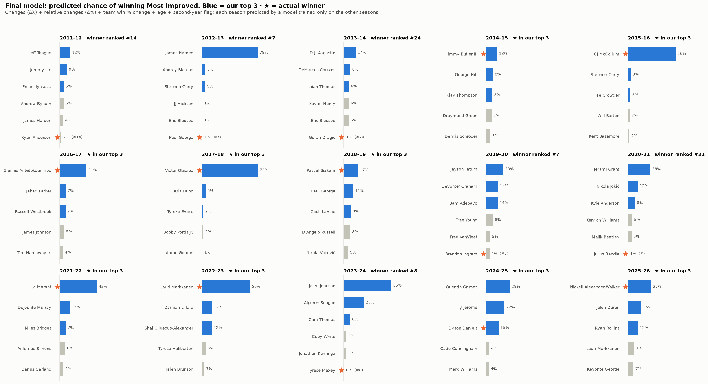 | 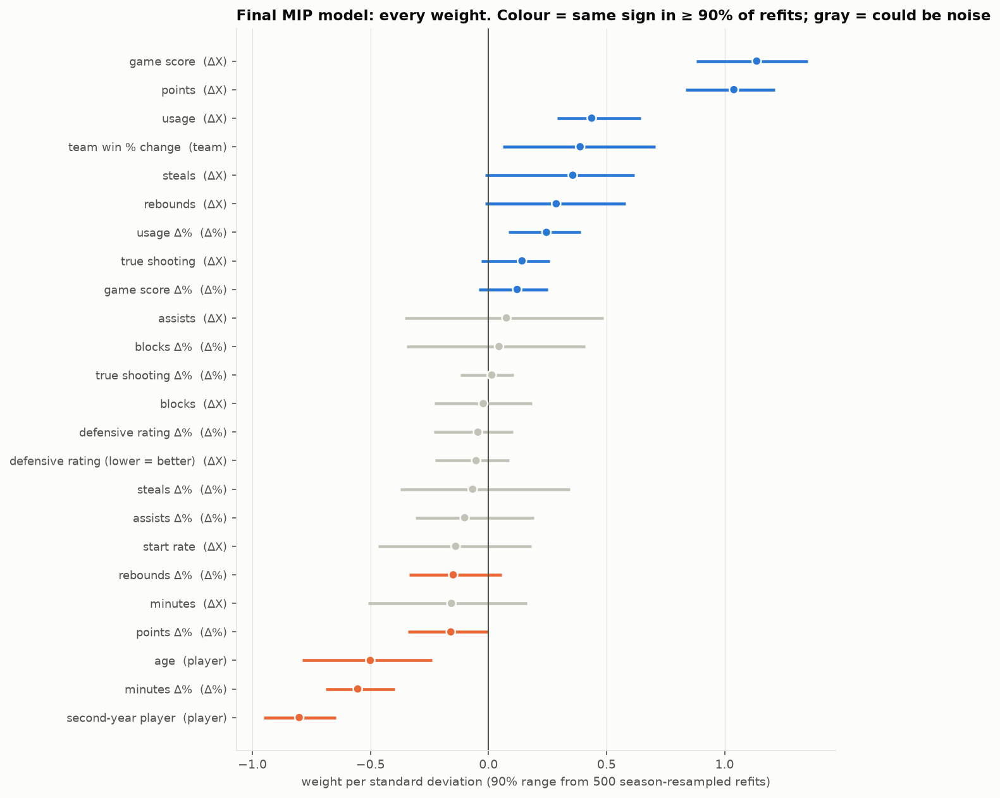 |
| Predicted chance of winning (blue = our top 3, ★ = winner) | Every model weight, with 90% ranges from 500 refits |
| 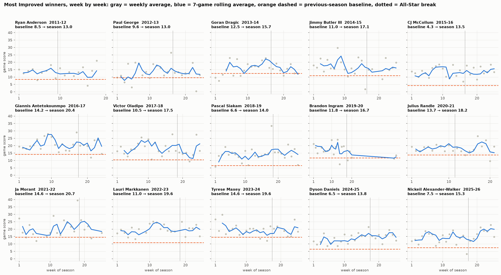 | 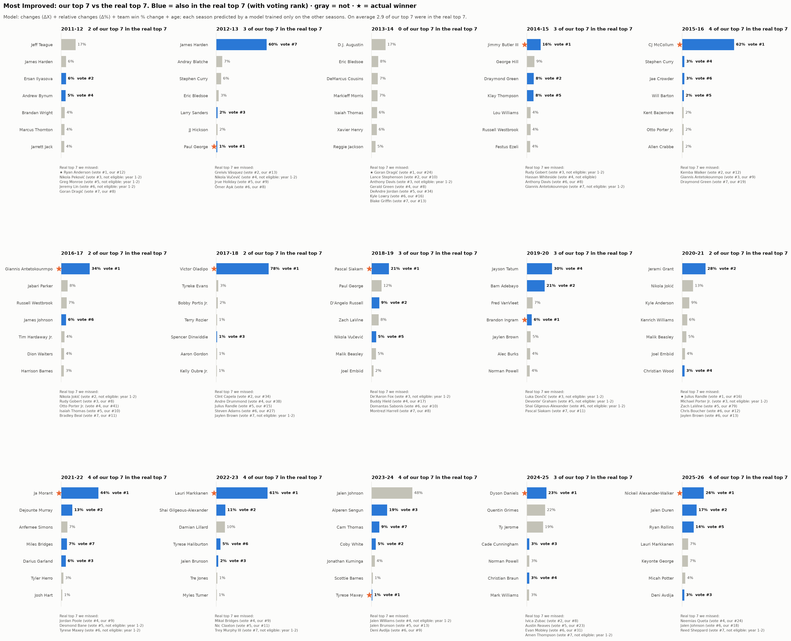 |
| Each winner's season, week by week, against his baseline | Our top 7 vs the real voting top 7 |

**Limits:** 15 winners is a small sample, and the model sees box-score changes only. Awards that turned on narrative stay partly unexplained.

</details>

<details>
<summary><b>Predicting before the season: what preseason is worth</b> (<a href="notebooks/11_mip_preseason.ipynb">notebook 11</a>)</summary>

- **Inputs:** last season, plus preseason form per 36 minutes (never totals), shrunk for small samples.
- **What preseason is worth:** minute increases hold at about 60–75%, decreases mean almost nothing, and shot volume per minute is the most reliable preseason signal.
- **Track record:** from about 350 candidates, the eventual winner was in our preseason top 7 in 4 of 14 seasons and in our top 20 in 11. It is a shortlist, not a forecast.
- **Backtest of the picks:** 36% of past top-7 picks jumped 3+ points a game (14% of all candidates), and half of the top-3 picks did. A better breakout list than an award list.
- **Established scorers:** instead of excluding them, last season's scoring counts slightly in a player's favour up to a turning point and against him above it (MVP material, not MIP). Backtesting every turning point from 14 to 26 points a game, **20 fits best**.
- **2026-27 top 7 (complete preseason):** Jalen Duren, Tyrese Haliburton, Tristan da Silva, Leonard Miller, Ty Jerome, Rui Hachimura, Reed Sheppard.

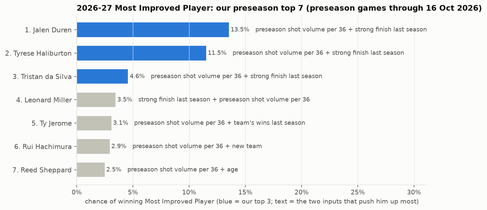

</details>

## The live 2026-27 Most Improved race

> [!TIP]
> **Last updated 28 October 2026 (day 9 of the season).** Re-run [notebook 12](notebooks/12_mip_live_race.ipynb) to add the newest days.

- **Leader:** Ty Jerome, #1 every day since his first game: 29.8 points a game in 31.5 minutes, up from 12.5 in 19.9 (about a 46% chance). He was #5 in our preseason top 7.
- **Behind him:** Ja'Kobe Walter, Terrence Shannon Jr, Brandon Miller, Ajay Mitchell, Alperen Sengun, RJ Barrett.
- **A leaderboard for every day, with no leakage.** Day *n* uses only games up to day *n*, scored by a model trained on past seasons cut at the same day. Each day is saved once and never recomputed.
- **Everyone is a candidate,** including previous winners and established scorers; the scoring turning point at 20 points a game handles the latter.

| | |
|---|---|
|  | 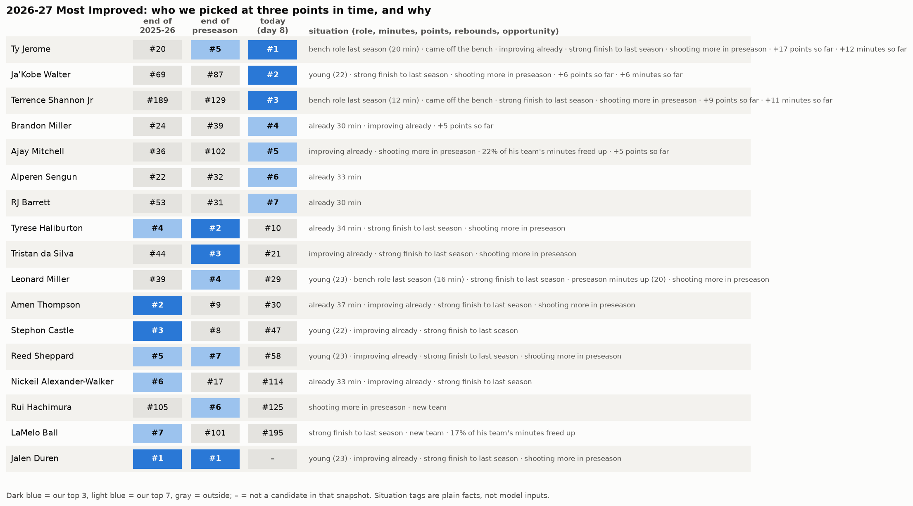 |
| Our rank for everyone who has been in the top 7, day by day | End of 2025-26 vs end of preseason vs today, with the reasons |

<details>
<summary><b>How much to trust it: backtests</b></summary>

- **How early is too early?** At day 2 the eventual winner was in our top 7 in 4 of 15 past seasons; by day 60, in 11 of 15.
- **Backtest of 2021-22 → 2025-26 (strict, earlier seasons only):** the winner was in our end-of-previous-season top 7 once, in our preseason top 7 never, and in our mid-January top 7 in **4 of 5 seasons** (median rank 2).
- **Pre-season lists find who is set up to improve, not who wins:** Lauri Markkanen, Dyson Daniels and Nickeil Alexander-Walker all ranked 14th or lower before their seasons began.
- **Do leaps last?** 9 of 14 past winners kept at least 80% of their jump the next season; three fell back about 4 points (Goran Dragić, Victor Oladipo, Julius Randle). Nickeil Alexander-Walker has kept 89% so far; we revisit at the All-Star break.

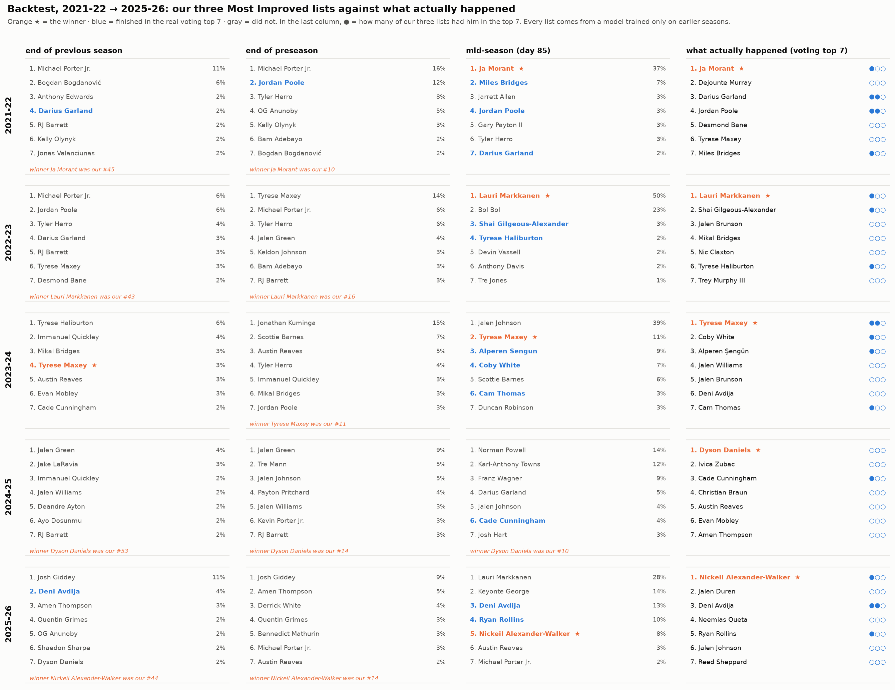

</details>

---

## How it works

| Notebook | What it does |
|---|---|
| `00`–`01` | Setup; which `nba_api` endpoints are league-wide and time-correct |
| `02_player_seasons` | 733 cached API responses → clean player-season table; shrinkage of noisy shooting %; season-relative scaling |
| `03_player_trajectories` | Level, trend and change for every feature, tested to be leakage-free |
| `04_unicorn_hunting` | Listed / body / style position spectrum; rarity and strangeness scores |
| `05_breakout_hunting` | Breakout labels relative to each player's own past; our own six-pillar star metric |
| `06_breakout_backtest` | Walk-forward backtest: rules, logistic, boosted trees, comps; intervals, calibration, sensitivity |
| `07_current_players` | 2026-27 outlook; Dëmin profile and historical comps |
| `08_breakout_board` | Each season's top-10 breakout picks vs what happened (plus an interactive page in `outputs/breakout_board.html`) |
| `09_routes_to_stardom` | Breakout route vs steady route into the star tier |
| `10_mip_leaps` | Most Improved Player: weekly leaps, the choice model, the mid-season race, our top 7 vs the real vote |
| `11_mip_preseason` | What preseason numbers are worth; a preseason top 7 for 2026-27 |
| `12_mip_live_race` | The live 2026-27 race, day by day; three snapshots with reasons; backtests |
| `13_archetypes` | *In progress:* player archetypes by playing style; who is similar to whom |

**Anti-leakage rules**
- Features for season *t* use seasons ≤ *t* only; notebook 03 checks this by deleting later seasons and confirming nothing changes.
- A training example is used only once its outcome was known at prediction time.
- Preprocessing is fitted inside each fold.

Every significant choice, with its evidence, is logged in [docs/DECISIONS.md](docs/DECISIONS.md) (28 decisions).

<details>
<summary><b>Data traps found along the way</b></summary>

- NBA.com's `PlayerIndex` returns *current* heights and positions for past seasons (a leakage trap).
- The 2019 switch to measured heights made 56% of players shorter overnight.
- The bio endpoint gives some players the wrong draft record.
- NBA.com's PIE rating over-represents big men among "stars" about 2×.

</details>

## Reproduce

```bash
git clone https://github.com/dan-j-e/unicorn-hunting.git && cd unicorn-hunting
python -m venv .venv && source .venv/bin/activate
pip install -r requirements.txt
pip install -e .                 # makes `import unicorn` available
python -m unicorn.download       # ~733 NBA.com requests, ~40 min first time, resumable
```

Then run the notebooks in order (`00` → `13`). Each writes the table the next one reads. Raw responses are cached in `data/raw/`, so re-runs make no API calls. Notebook 10 also fetches 16 seasons of game logs and 15 Basketball-Reference award pages (cached). There is also a local Streamlit dashboard for changing the star-score weights and breakout thresholds: `streamlit run dashboard/app.py`.

<details>
<summary><b>Project structure</b></summary>

```
notebooks/        numbered research pipeline (00 → 13), saved with outputs
src/unicorn/      reusable code
  raw, download            cached NBA.com access and the full download list
  player_season, columns   clean tables and the data dictionary
  features, trajectories   shrinkage, season-relative scaling, leakage-safe trends
  position, unicorn        position spectrum and unicorn scores
  labels, backtest, comps  breakout/star labels, walk-forward engine, comparables
  gamelogs, mip, bref      game-level data, the Most Improved model, voting results
  preseason                preseason game logs and the pre-opening-night view of each player
  board, stats, plotting   breakout board, statistics helpers, chart style
dashboard/app.py  Streamlit app
docs/DECISIONS.md decision log
outputs/          figures and tables
data/             raw and processed data (git-ignored, rebuilt from code)
```

</details>

## Limitations
- **Box-score data only** (NBA.com). No play-by-play, lineups, injuries, contracts or scouting; on-court net rating mixes player and team quality.
- **Few positive cases:** about 26 future stars, 28 production breakouts and 15 MIP winners, so those results have wide intervals.
- **"Star" is our own definition** (six equally weighted pillars); one-dimensional scorers rarely qualify, by design.
- **One rookie season is thin evidence.** Predictions for second-year players are far better informed than for rookies.

## What's next
See [TODO.md](TODO.md): player archetypes and "who is similar to who", explained picks, a story-led write-up, and tracking the 2026-27 predictions.
