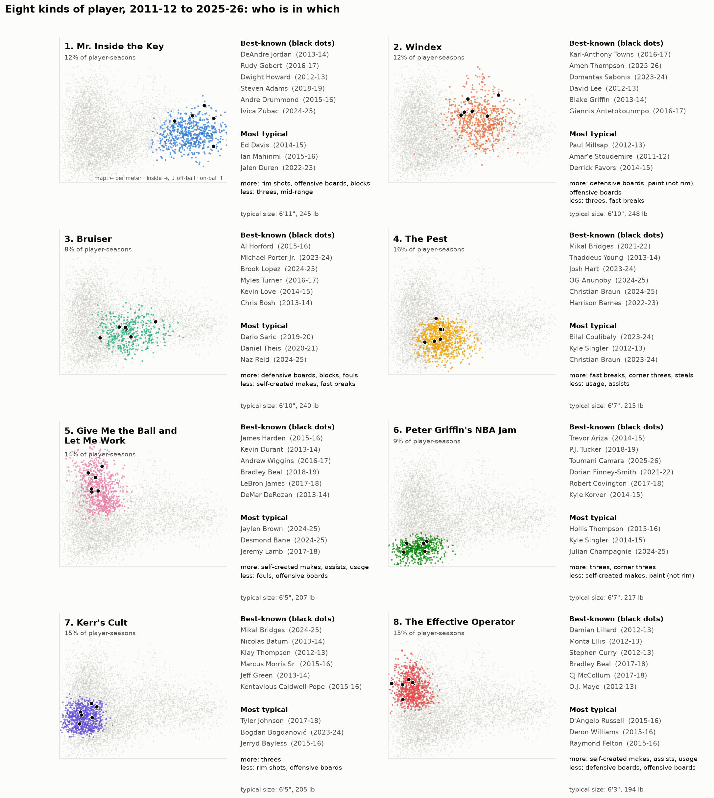
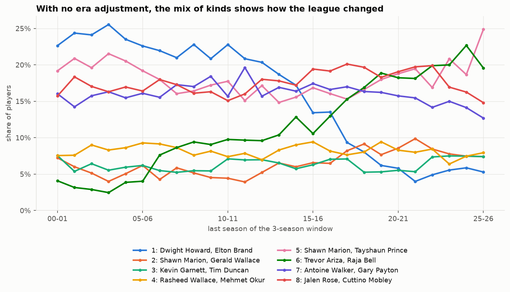

# Eight kinds of NBA player (2011-12 to 2025-26)

*From [notebook 2](../notebooks/2_play_styles.ipynb) (playing styles); every intermediate step is in the archived [notebook 13](../notebooks/archive/13_archetypes.ipynb). Decisions D31, D34 and D35 in [DECISIONS.md](DECISIONS.md).*

We sorted every NBA player-season since 2011-12 (500+ minutes, 5,353 seasons) by **how** each player plays, not **how well**. The data drew the groups, not us: no names, size or position went in, and no list of expected types was written beforehand. The clusters were numbered first and named afterwards, from the players inside them.

## How the clusters were made

- **15 style measures**, all shares or rates, so they describe the shape of a player's game rather than how much he plays:
  - **Where he shoots:** rim, paint, mid-range, threes, corner threes, free throws per shot.
  - **How he creates:** usage, self-created (unassisted) makes, assist rate, fast-break points.
  - **Rebounding:** offensive and defensive rebound rates.
  - **Box-score defence:** blocks, steals, fouls.
- **Each measure is compared with that season's league.** A 2014 big who shot some threes counts as "stretchy" even though the bar is higher in 2025.
- **Left out on purpose:** shooting percentages, plus-minus and all-in-one ratings, so a good and a bad rim-runner land together. Height, weight and position were also left out, and are shown only afterwards.
- **A soft mixture model**, so each season gets a share in every cluster. It turned out to be confident about almost everyone: 90%+ of seasons are 70%+ in one cluster.
- **Why eight:** style is mostly a continuum. Three clusters are the most stable cut, and five and six are about equally stable; beyond six the groups get shakier. But the 8 fit neatly inside the 5, and each extra split has a basketball reading.

## The eight

Numbered from most inside (1) to most perimeter, then named. "Best-known" means the most minutes among clear members. "Most typical" means closest to the cluster's centre, which tends to mean role players, because stars are extreme even within their own type.

| # | Name | Share | Best-known | Most typical | Does more | Does less | Typical size |
|---|---|---|---|---|---|---|---|
| **1** | **Mr. Inside the Key** | 12% | DeAndre Jordan, Rudy Gobert, Dwight Howard, Steven Adams, Andre Drummond, Ivica Zubac | Ed Davis, Ian Mahinmi, Jalen Duren | rim shots, offensive boards, blocks | threes, mid-range | 6'11", 245 lb, C |
| **2** | **Windex** | 12% | Karl-Anthony Towns (2016-17), Amen Thompson, Domantas Sabonis, David Lee, Blake Griffin, Giannis Antetokounmpo (2016-17) | Paul Millsap, Amar'e Stoudemire, Derrick Favors | defensive boards, paint (not rim), offensive boards | threes, fast breaks | 6'10", 248 lb, F |
| **3** | **Bruiser** | 8% | Al Horford, Michael Porter Jr., Brook Lopez, Myles Turner, Kevin Love, Chris Bosh | Dario Šarić, Daniel Theis, Naz Reid | defensive boards, blocks, fouls | self-created makes, fast breaks | 6'10", 240 lb, F |
| **4** | **The Pest** | 16% | Mikal Bridges (2021-22), Thaddeus Young, Josh Hart, OG Anunoby, Christian Braun, Harrison Barnes | Bilal Coulibaly, Kyle Singler, Christian Braun | fast breaks, corner threes, steals | usage, assists | 6'7", 215 lb, F |
| **5** | **Give Me the Ball and Let Me Work** | 14% | James Harden, Kevin Durant, Andrew Wiggins, Bradley Beal (2018-19), LeBron James, DeMar DeRozan | Jaylen Brown, Desmond Bane, Jeremy Lamb | self-created makes, assists, usage | fouls, offensive boards | 6'5", 207 lb, G |
| **6** | **Peter Griffin's NBA Jam** | 9% | Trevor Ariza, P.J. Tucker, Toumani Camara, Dorian Finney-Smith, Robert Covington, Kyle Korver | Hollis Thompson, Kyle Singler, Julian Champagnie | threes, corner threes | self-created makes, paint (not rim) | 6'7", 217 lb, F |
| **7** | **Kerr's Cult** | 15% | Mikal Bridges (2024-25), Nicolas Batum, Klay Thompson, Marcus Morris Sr., Jeff Green, Kentavious Caldwell-Pope | Tyler Johnson, Bogdan Bogdanović, Jerryd Bayless | threes | rim shots, offensive boards | 6'5", 205 lb, G |
| **8** | **The Effective Operator** | 15% | Damian Lillard, Monta Ellis, Stephen Curry, Bradley Beal (2017-18), CJ McCollum, O.J. Mayo | D'Angelo Russell, Deron Williams, Raymond Felton | self-created makes, assists, usage | defensive and offensive boards | 6'3", 194 lb, G |

The full profile on all 15 measures is in [the heatmap](../outputs/figures/2_eight_kinds_profile.png).

## What's interesting

- **The eight fit neatly inside the five.** Cluster 1 stays whole; 2 and 3 split from one inside group; 4 and 6 from the off-ball wings; 5 and 8 from the on-ball group; 7 stays whole. So eight is a finer cut of the same picture, not a different one.
- **Players move between clusters as their game changes.**
  - Mikal Bridges was The Pest (4) in 2021-22 and in Kerr's Cult (7) by 2024-25.
  - Karl-Anthony Towns in 2016-17 was a Windex (2), before he became one of the league's great shooting big men.
  - Bradley Beal moved from The Effective Operator (8) to Give Me the Ball and Let Me Work (5) in a single year.
- **Give Me the Ball (5) and The Effective Operator (8) both create their own shots.** The difference is size and rebounding: the Operators are smaller (6'3" against 6'5") and rebound less.
- **Surprising 2025-26 placements:**
  - **Victor Wembanyama is a Windex (2), not a Bruiser (3).** Compared with the league, his rim shots, rebounding and blocks outweigh his threes.
  - **Draymond Green is in Kerr's Cult (7).** Fittingly. His three-point rate went up while his rebounding and rim shots fell.
  - **Dyson Daniels and Amen Thompson are Windex (2).** Their rebounding, rim shots and lack of threes look like a forward's.
  - **Shai Gilgeous-Alexander, Luka Dončić and Cooper Flagg are Give Me the Ball and Let Me Work (5); Stephen Curry and Jalen Brunson are Effective Operators (8).**
- **The mix of roles has shifted.** At the five-cluster level, off-ball wings went from 17% to 28% of players since 2011-12, and rim-running bigs from 15% to 10%. Because each measure is compared within its own season, this is a change in what teams ask players to do, not just everyone shooting more threes.

## Caveats

- **The eight are less stable than the five.** Fitted on two random halves of the data, they agree 54% of the time, against 83% for five (averaged over 20 pairs of halves; revised 13 November from 87%, which came from six pairs). The groups in the middle of the map (Windex/Bruiser; The Pest/Peter Griffin's NBA Jam/Kerr's Cult) swap players most often.
- **Era:** each season is compared with its own league, so a cluster means the same *relative* role in 2012 and 2025, not the same raw numbers.
- **Next:** the same exercise from 2000-01 to 2025-26 on 3-season rolling averages, to see whether the eight hold over a longer history.

## Longer history: 2000-01 to 2025-26 (notebook 2, section 2D)

We reran the same exercise over 26 seasons, using **3-season rolling windows** and **no era adjustment**: raw values on one scale, so the league's changes show up in the clusters.

- **The traditional rim big fell from 23% of players to 5%.** It was the largest group until about 2012, then collapsed by 2018. Typical members: Dwight Howard, Elton Brand, Ben Wallace, Dikembe Mutombo.
- **The corner 3-and-D wing rose from 4% to 20%.** Bruce Bowen, Raja Bell and Shane Battier were early examples; Trevor Ariza and P.J. Tucker came later.
- **Usage-heavy bigs and pick-and-pop bigs held steady at 6–9%,** from Garnett, Duncan and Dirk to Jokić, Giannis and Towns.
- **Players move as the league moves.** Brook Lopez went from rim big to pick-and-pop big between 2014 and 2018; Shaquille O'Neal moved the other way as his usage fell.
- **Caveat:** these clusters are less stable than the 2011-26 ones (0.45 against 0.54), partly because boundary players switch as the league shifts. Stephen Curry alternates between the two guard clusters.

The full 2000-26 picture: [who is in which](../outputs/figures/13_eight_clusters_2000_2026_who.png) · [profiles](../outputs/figures/13_eight_clusters_2000_2026.png).
